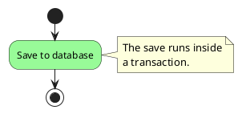

# Behaviour Diagrams

Sequence, activity, state and timing diagrams. All wrapped in `@startuml` /
`@enduml`.

This file covers the syntax. For the UML vocabulary each diagram kind may use
and the constraints PlantUML will happily let you break, read
[uml-conformance.md](uml-conformance.md).

## Sequence diagrams

`->` sends a message; `-->` (dashed) is the convention for a reply. Participants
appear in the order first encountered.

```plantuml
Alice -> Bob : Authentication request
Bob --> Alice : Authentication response
```

### Participants

Declare them to control order and shape: `participant`, `actor`, `boundary`,
`control`, `entity`, `database`, `collections`, `queue`.

```plantuml
actor User
boundary Login
control AuthService
database Store
participant "Payment Gateway" as PG #99FF99
```

Append `order <n>` to a declaration to fix the display order independently of
first mention.

### Arrow styles

| Style | Syntax |
| ----- | ------ |
| Reply / dashed | `-->` |
| Lost message | `->x` |
| Thin arrowhead | `->>` |
| Coloured line | `-[#red]>` |
| Bidirectional | `<->` |

### Numbering

`autonumber` prefixes an incrementing number; it takes a start, an increment and
a format string (`0` mandatory digit, `#` shown only when present).

```plantuml
autonumber 10 10 "<b>[000]"
Alice -> Bob : first
Bob --> Alice : second
```

### Grouping

`alt`/`else`, `opt`, `loop`, `par` — close every frame with `end`; nest freely.

```plantuml
Alice -> Bob : Authentication request
alt successful case
    Bob --> Alice : Accepted
    loop 3 times
        Alice -> Bob : heartbeat
    end
else failure
    Bob --> Alice : Rejected
end
```

### Activation

`activate` / `deactivate` draw the busy bar; `destroy` ends a lifeline. Nested
activations stack, which shows a call chain.

```plantuml
Alice -> Bob : request
activate Bob
Bob -> Carol : delegate
activate Carol
Carol --> Bob : result
deactivate Carol
deactivate Bob
```

### Notes, dividers, delays

- `note left` / `note right` attach to the most recent message.
- `note over A, B` anchors to participants; `note` ... `end note` for multi-line.
- `== text ==` inserts a labelled phase divider.
- `...` draws a delay, optionally captioned: `... waiting for timeout ...`.

## Activity diagrams (current syntax)

An action is `:label;`. Actions link in the order written. Use the current
syntax, not the legacy `(*)` notation.

```plantuml
start
:Open the file;
:Read the contents;
stop
```

`start` begins the flow; `stop` or `end` terminates it.

### Conditionals

```plantuml
start
if (Cache hit?) then ([yes])
  :Return cached value;
else ([no])
  :Compute value;
endif
stop
```

The parenthesised text is the guard on the edge leaving the decision node. UML
2.5.1 §15.2.4 shows guards in **square brackets**, and PlantUML prints activity
guards verbatim, so write the brackets yourself: `then ([yes])` renders `[yes]`,
`then (yes)` renders a bare `yes`. (Sequence diagrams are the opposite — there
PlantUML supplies the brackets.)

Chain further tests with `elseif`. When one value selects among many paths,
`switch` / `case` / `endswitch` reads better than a long chain.

### Loops

The same bracket rule applies to every loop and `switch` label — they are all
guards on the edges out of a decision node.

| Loop | Behaviour |
| ---- | --------- |
| `repeat` ... `repeat while (cond) is ([yes]) not ([no])` | body runs at least once, test at the end |
| `while (cond) is ([more])` ... `endwhile ([empty])` | test first, body may run zero times |
| `switch (kind?)` / `case ([a])` / `case ([b])` / `endswitch` | one value selects among many paths |

### Concurrency

- `fork` / `fork again` / `end fork` — a ForkNode splits the flow into
  concurrent branches and a JoinNode resynchronises them. Branches that are not
  meant to rejoin end in their own `end` (flow final) instead.
- `end merge` also closes a `fork`, but draws a **merge diamond** in place of the
  join bar. Avoid it: a MergeNode does not synchronise (UML 2.5.1 §15.3.3.5), so
  everything downstream of it runs once per branch. A merge belongs after a
  decision, and `if` ... `endif` already draws that pair for you.
- `split` / `split again` / `end split` — branches the flow with no control node
  at all: no bar, no diamond. That is not UML notation. Use `fork` for
  concurrency and `if` ... `endif` for alternative paths.

See section 11 of [uml-conformance.md](uml-conformance.md) for the full set of
control-node rules.

### Grouping and swimlanes

`partition` (also `group`, `package`, `card`) labels a phase. The pipe `|`
assigns actions to swimlanes.

```plantuml
|Customer|
start
:Place order;
|#AntiqueWhite|Warehouse|
:Pick items;
stop
```

### Colour and notes

Colour actions with a `<style>` block and a stereotype. The older
`#palegreen:Save to database;` prefix form still parses on PlantUML 1.2026.6 and
earlier, but is a **syntax error from 1.2026.7 onwards**; the `<style>` form
works on every version.



## State diagrams

`[*]` is the initial and final pseudo-state; `-->` is a transition;
`State : text` adds a description.

```plantuml
[*] --> Idle
Idle --> Running : start
Running --> [*] : shutdown
```

### Composite states

```plantuml
state Operating {
  [*] --> Idle
  Idle --> Configuring : EvConfig
}
```

### Pseudo-states and regions

| Feature | Syntax |
| ------- | ------ |
| Shallow / deep history | `[H]` / `[H*]` |
| Fork / join | `state f <<fork>>`, `state j <<join>>` |
| Choice with guards | `state c <<choice>>`, then `c --> Minor : [id <= 10]` |
| Concurrent regions | `--` (horizontal) or `\|\|` (vertical) inside a composite state |
| Long name alias | `state "Accumulate Enough Data" as collecting` |

### Notes and colour

`note left of`, `note right of`, `note top of`, `note bottom of`, and
`note on link` for a transition.

```plantuml
state Healthy #palegreen
state Degraded #gold ##[dashed]orange
state Down #pink ##[bold]red
```

## Timing diagrams

Declare signals, then set their state at points in time with `@<time>` and `is`.

Signal types: `robust` (multi-state), `concise` (simplified data line), `binary`
(two-level), `analog` (interpolated), `clock` (repeating pulse).

```plantuml
robust "Web Browser" as WB
concise "Web User" as WU
@0
WU is Idle
WB is Idle
@100
WU is Waiting
WB is Processing
```

A clock repeats automatically given a period; a binary signal toggles between
`low` and `high` at the times given.

```plantuml
clock clk with period 1
binary "Enable" as EN
@0
EN is low
@5
EN is high
```

Messages between signals use the same arrow notation as a transition label.
