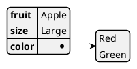
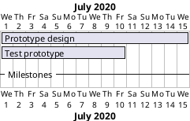
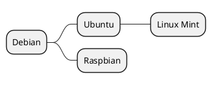
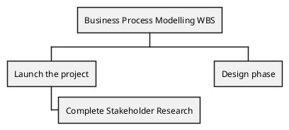
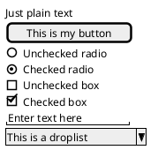
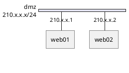
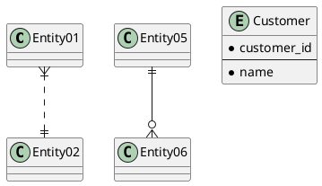
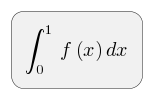
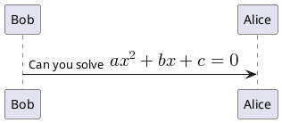

# Other Diagram Types

> **Not UML.** No diagram type in this file is defined by OMG UML 2.5.1 — not
> even the ones that use `@startuml`. They are legitimate in their own right (a
> Gantt chart is a Gantt chart), but none of them may be delivered where a UML
> diagram is required. See
> [uml-conformance.md](uml-conformance.md) for what to use instead.

Note which markers each one uses — several do **not** use `@startuml`.

## JSON data

`@startjson` / `@endjson`. Everything between is parsed as standard JSON and laid
out as nested boxes, with arrays shown as ordered lists.



Objects and arrays nest to any depth; each nested object becomes its own
sub-table linked to its parent key.

## YAML data

`@startyaml` / `@endyaml`, with the same idea as JSON.


## Gantt charts

`@startgantt` / `@endgantt`. Tasks go in square brackets; `requires` states the
workload. `--` inserts a labelled divider.



- Durations in `days` or `weeks`.
- Anchor tasks with `starts` / `ends`, using a calendar date or a relative
  offset such as `D+15`.
- Join several facts about one task with `and`.

## MindMap

`@startmindmap` / `@endmindmap`. Three interchangeable notations:

| Notation | Depth from |
| -------- | ---------- |
| OrgMode | number of leading `*` (one = root) |
| Markdown | leading whitespace, one bullet per line |
| Arithmetic | `+` places a branch right of the root, `-` left |



## Work breakdown structure

`@startwbs` / `@endwbs`. Same notation family as MindMap; depth comes from
indentation.



Append `<` or `>` to a node marker to push that branch left or right of its
parent; `+` and `-` choose the side as in MindMap.

## Salt wireframes

`@startsalt` / `@endsalt`, or `@startuml` followed by a line containing only
`salt`. The window is wrapped in braces. For layout and organisation, not
pixel-perfect mock-ups.



`|` separates columns, turning consecutive lines into a table.

## Network diagrams (nwdiag)

`@startnwdiag` / `@endnwdiag`, with the body wrapped in `nwdiag { ... }`. Declare
networks with an `address` range; name nodes inside a network's braces.



Some documentation shows nwdiag inside a plain `@startuml` block. PlantUML
1.2026.6 rejects that and says so explicitly: *"This looks like a network
diagram. Please use @startnwdiag instead of @startuml."* Use `@startnwdiag`.

A node named on more than one network is drawn with a vertical link joining its
positions — that is how a multi-homed host is shown.

## ArchiMate

A separate modelling language from UML, with its own metamodel. Never mix
ArchiMate elements into a UML diagram.

Standard `@startuml` wrapper. The `archimate` keyword takes a layer colour
(`#Business`, `#Application`, `#Technology`), a label, an `as` alias and an
optional stereotype that adds a matching icon.

```plantuml
@startuml
archimate #Technology "VPN Server" as vpnServer <<technology-device>>
@enduml
```



Including the standard library gives a macro per element type, following
`Category_ElementName(alias, "label")`:

```plantuml
!include <archimate/Archimate>
Motivation_Stakeholder(stakeholder, "Project Sponsor")
```

## Entity-relationship (information engineering)

Crow's-foot notation is not UML. Where the deliverable is UML, model the same
thing as a class diagram with associations and multiplicities.

Standard `@startuml`. Use `entity` in place of `class`. Connector symbols encode
cardinality at each end:

| Symbol | Cardinality |
| ------ | ----------- |
| `\|o` | zero or one |
| `\|\|` | exactly one |
| `}o` | zero or many |
| `}\|` | one or many |



A `--` line separates identifying keys above from remaining attributes below; a
leading `*` marks an attribute mandatory.

## Maths

Inside any diagram element, wrap AsciiMath in `<math>...</math>` or LaTeX in
`<latex>...</latex>`. Standalone diagrams use `@startmath` / `@endmath` or
`@startlatex` / `@endlatex`.





Use LaTeX when an expression needs constructs AsciiMath does not cover.

## Unicode

Non-Latin text and special characters may be used directly in labels; save the
source as UTF-8.

## Legacy activity syntax

Recognisable by `(*)` start/end markers and quoted activity names. Read it when
maintaining old diagrams, but write new ones with the current syntax in
[behaviour-diagrams.md](behaviour-diagrams.md).

```plantuml
(*) --> "First Action"
-->[then continue to] "Second Action"
--> (*)
```
