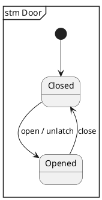
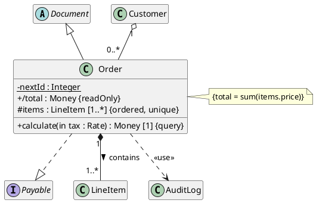
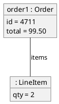
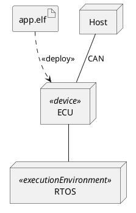
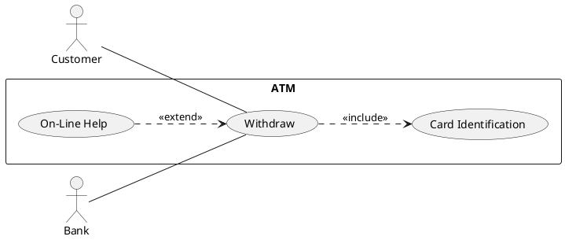
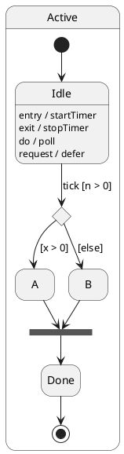
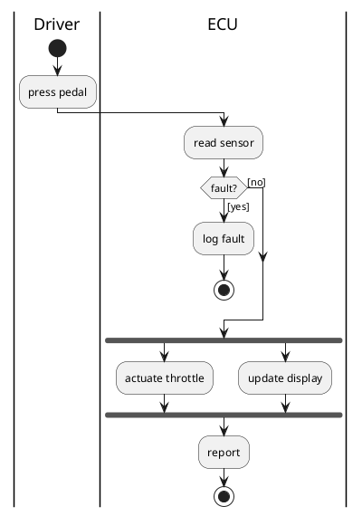
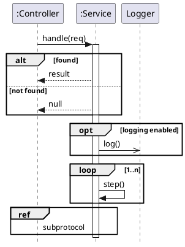
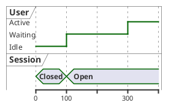

# UML 2.5.1 Conformance

Every `§` reference is to **OMG Unified Modeling Language 2.5.1**
(formal/2017-12-05). Read this file before writing a diagram that is meant to be
UML; read the diagram-type reference file for the syntax.

PlantUML is a drawing language, not a UML tool. It checks syntax, never
well-formedness. Every "wrong" cell in the tables below parses and renders
without complaint — and is still invalid UML.

## 1. Pick the diagram kind

UML 2.5.1 defines fourteen diagram kinds (§Annex A). A diagram's kind is decided
by the primary symbols in its contents area, not by a declaration.

| Diagram | Group | Frame heading | Abbrev. | Clause | PlantUML |
| ------- | ----- | ------------- | ------- | ------ | -------- |
| Class | structure | `class` | — | §11.4, §11.5 | `class`, `interface`, `enum` |
| Object | structure | `class` | — | §9.8 | `object` |
| Composite structure | structure | `class` | — | §11.2, §11.3 | nested `component`, `port` |
| Component | structure | `component` | `cmp` | §11.6 | `component`, `()` |
| Deployment | structure | `deployment` | `dep` | §19 | `node`, `artifact` |
| Package | structure | `package` | `pkg` | §12.2 | `package` |
| Profile | structure | `package` | `pkg` | §12.3 | `package`, `class <<stereotype>>` |
| Use case | behaviour | `use case` | `uc` | §18.1 | `actor`, `usecase` |
| Activity | behaviour | `activity` | `act` | §15 | `start`, `:action;` |
| State machine | behaviour | `state machine` | `stm` | §14 | `state`, `[*]` |
| Sequence | behaviour | `interaction` | `sd` | §17.8 | `participant`, `->` |
| Communication | behaviour | `interaction` | `sd` | §17.9 | numbered messages |
| Interaction overview | behaviour | `interaction` | `sd` | §17.10 | activity syntax + `ref` |
| Timing | behaviour | `interaction` | `sd` | §17.11 | `robust`, `concise` |

The frame and its heading are optional (§Annex A); when the frame is omitted, so
is the heading. Draw one with `mainframe` and the keyword above:



Mixing kinds is allowed where it helps (§Annex A NOTE) — a state machine nested
in an internal structure, for instance. It is not licence to invent a kind.

## 2. Notation shared by every diagram

### Visibility (§7.4, §9.5.4)

`+` public, `-` private, `#` protected, `~` package. Packages have only public
and private (§12.2.4) — never `#` or `~` on a package member.

PlantUML draws coloured icons instead of these symbols by default. Restore the
UML notation with `skinparam classAttributeIconSize 0`.

### Multiplicity (§7.5.4.1)

```text
<multiplicity>       ::= <multiplicity-range> [ '{' <order-designator> [',' <uniqueness-designator>] '}' ]
<multiplicity-range> ::= [ <lower> '..' ] <upper>
<order-designator>   ::= 'ordered' | 'unordered'
<uniqueness-designator> ::= 'unique' | 'nonunique'
```

`*` is the unlimited upper bound. `1` abbreviates `1..1`; `*` abbreviates `0..*`.
In a text string (an attribute) the multiplicity goes in square brackets; at an
association end it is written bare next to the line. An omitted multiplicity on
an attribute means exactly one — it does not mean "unspecified". An omitted
multiplicity on a *diagram* end permits no conclusion at all (§11.5.4 NOTE).

### Attributes and operations (§9.5.4, §9.6.4)

```text
<property>  ::= [<visibility>] ['/'] <name> [':' <type>] ['[' <multiplicity-range> ']']
                ['=' <default>] ['{' <prop-modifier> [',' <prop-modifier>]* '}']
<operation> ::= [<visibility>] <name> '(' [<parameter-list>] ')'
                [':' [<return-type>] ['[' <multiplicity-range> ']'] ['{' <oper-property>* '}']]
```

`/` marks a derived element. Property modifiers are `readOnly`, `union`,
`subsets <p>`, `redefines <p>`, `ordered`, `unordered`, `unique`, `nonunique`,
`seq`/`sequence`, `id`. Operation properties are `redefines <op>`, `query`,
`ordered`, `unordered`, `unique`, `nonunique`, `seq`/`sequence`. Do not invent
others; a project-specific annotation belongs in a stereotype or a constraint.

### Constraints (§7.6.4)

A constraint is a boolean expression in curly braces, placed next to the
constrained element or in an attached note. `{total = sum(items.price)}`, not a
free-text comment pretending to be one.

### Keywords and stereotypes (§Annex C, §22.3)

Keywords are reserved words in guillemets that identify a metaclass, a kind of
relationship, or the value of a modifier. PlantUML renders `<<x>>` as «x», which
is the fallback spelling the spec permits where guillemets are unavailable.

Keywords that matter when drawing (§Annex C, Table C.1):

| Placement | Keywords |
| --------- | -------- |
| Box header | `actor`, `artifact`, `component`, `dataType`, `device`, `enumeration`, `executionEnvironment`, `interface`, `model`, `primitive`, `profile`, `signal`, `statemachine`, `Stereotype`, `structured`, `centralBuffer`, `datastore`, `deployment spec` |
| Dashed-line label | `access`, `apply`, `bind`, `deploy`, `extend`, `flow`, `import`, `include`, `manifest`, `merge`, `occurrence`, `substitute`, `use` |
| Line label | `decisionInputFlow`, `multicast`, `multireceive` |
| Swimlane header | `external` |
| After name | `extended`, `final`, `protocol` |

The Standard Profile (§22.3) adds stereotypes, not keywords: «Auxiliary»,
«BuildComponent», «Call», «Create», «Derive», «Destroy», «Document», «Entity»,
«Executable», «File», «Focus», «Framework», «Implement»,
«Implementation Class», «Instantiate», «Library», «Metaclass», «Metamodel»,
«ModelLibrary», «Process», «Realization», «Refine», «Responsibility», «Script»,
«Send», «Service», «Source», «Specification», «Subsystem», «SystemModel»,
«Trace», «Type», «Utility».
Each applies to one metaclass only — «Subsystem» and «Entity» apply to a
Component, «Focus» and «Auxiliary» to a Class, «Executable» to an Artifact.

Anything else in guillemets is a stereotype from some profile. That is legal,
but say which profile it comes from, and do not reuse a keyword's spelling for
a different meaning (§Annex C discourages it explicitly).

## 3. Class diagrams (§9, §11.4, §11.5)

**Elements.** Class, abstract Class, Interface, DataType, PrimitiveType,
Enumeration, Signal, AssociationClass, Package, Constraint, Comment.

**Relationships.** Generalization (solid line, hollow triangle),
InterfaceRealization (dashed line, hollow triangle), Association (solid line,
optionally with a hollow or filled diamond), Dependency (dashed line, open
arrowhead), and the stereotyped dependencies «use», «substitute», «bind».

| Rule | § | In PlantUML |
| ---- | - | ----------- |
| The multiplicity at the composite (filled diamond) end must have an upper bound of 1 | §9.9 `multiplicity_of_composite` | `Car "1" *-- "4" Wheel` ✔ · `Car "*" *-- "4" Wheel` ✘ |
| A binary association has at most one end with shared or composite aggregation | §11.5.4 | `A *-- B` ✔ · `A *--* B` ✘ |
| A classifier implements an Interface through an InterfaceRealization (dashed line, hollow triangle), never a Generalization. Generalization between two Interfaces is fine | §10.4.3, §10.4.4 | `Order ..\|> Payable` ✔ · `Order --\|> Payable` ✘ |
| An n-ary association is drawn as a diamond, never as a chain of binary lines | §11.5.4 | `diamond dia` with one line per end |
| An AssociationClass is a class symbol attached to the association path by a dashed line, and carries a single name | §11.5.4 | `(Student, Course) .. Enrollment` |
| Navigability is an open arrowhead; a small x is explicit non-navigability. The old "arrow implies ownership" convention is deprecated | §11.5.4 | do not read `-->` as ownership |
| A derived element carries a leading `/` | §9.5.4 | `+ /total : Money` |



## 4. Object diagrams (§9.8)

**Elements.** InstanceSpecification, Slot, Link (an instance of an Association).

| Rule | § | In PlantUML |
| ---- | - | ----------- |
| An instance name is `name : Classifier`, underlined; an anonymous one is `: Classifier` | §9.8.4 | PlantUML does not underline — keep the colon form so the instance reading is unambiguous |
| A slot uses `=`, not `:` | §9.8.4 | `id = 4711` ✔ · `id : 4711` ✘ |
| Links are plain solid lines between instances; multiplicity is a type-level concept | §9.8.4 | no `"1"`/`"*"` on an object-diagram line |
| No generalization, realization or aggregation between instances | §9.8.4 | `o1 <\|-- o2` ✘ |
| Navigation arrows, if shown, must agree with the association's ends | §9.8.4 | |



## 5. Package diagrams (§12.2)

**Elements.** Package, Model «model», Profile «profile», PackageImport,
PackageMerge, Dependency.

| Rule | § | In PlantUML |
| ---- | - | ----------- |
| Package members have public or private visibility only | §12.2.4 | `+Foo`, `-Bar`; never `#`/`~` |
| «import» is a public PackageImport, «access» a private one | §Annex C | pick the one you mean |
| A PackageMerge arrow points from the receiving package to the merged package | §12.2.4 | `Target ..> Source : <<merge>>` |
| A URI is shown as `{uri = ...}` after the name | §12.2.4 | |

## 6. Component diagrams (§11.6)

**Elements.** Component «component», Interface (ball and socket), Port,
Connector, Artifact, ComponentRealization, Usage «use».

| Rule | § | In PlantUML |
| ---- | - | ----------- |
| A provided interface is a ball, a required interface a socket | §11.6.4, §10.4.4 | `Engine -up- ITorque` / `Gearbox -up-( ITorque` |
| ComponentRealization is a dashed line with a hollow triangle, from the realizing classifier to the component | §11.6.4 | `Impl ..\|> Comp` |
| «Subsystem» is a Standard Profile stereotype on a Component, not a metaclass | §22.3 | `component X <<Subsystem>>` |
| An Artifact manifests a Component; a Component is not itself deployed | §19.3.3 | `artifact A ..> Comp : <<manifest>>` |

## 7. Composite structure diagrams (§11.2, §11.3)

**Elements.** Property acting as a part (`name : Type [n]` in a box), Port (small
square on the border), Connector (assembly and delegation), Collaboration
(dashed ellipse), CollaborationUse «occurrence».

| Rule | § | In PlantUML |
| ---- | - | ----------- |
| A part box shows `rolename : Type`, with its multiplicity in the corner | §11.2.4 | `component "wheels : Wheel [4]"` |
| A part drawn with a solid border is owned by composition; a referenced part has a dashed border | §11.2.4 | PlantUML has no dashed-part form — say which you mean in a note |
| Ports sit on the classifier border | §11.3.4 | `portin`, `portout`, `port` |
| A delegation connector runs between a port and an internal part; an assembly connector between two parts | §11.2.3 | |

PlantUML's support is partial. Where the notation is not available, prefer a
class diagram with explicit composition over a composite structure diagram that
only looks right.

## 8. Deployment diagrams (§19)

**Elements.** Node, Device «device», ExecutionEnvironment «executionEnvironment»,
Artifact «artifact», Deployment «deploy», Manifestation «manifest»,
CommunicationPath, DeploymentSpecification «deployment spec».

| Rule | § | In PlantUML |
| ---- | - | ----------- |
| A deployment target is a Node, Device, ExecutionEnvironment, a part, or an InstanceSpecification — never a Class or Component | §19.2.3 | `app.elf ..> ecu : <<deploy>>` ✔ · `Comp ..> ecu : <<deploy>>` ✘ |
| Artifacts are deployed. A Component reaches a node only by being manifested in an Artifact first | §19.3.3 | `artifact ..> component : <<manifest>>`, then deploy the artifact |
| The deployment arrow runs from the artifact to the target | §19.2.4 | |
| A CommunicationPath is an association between nodes: a plain solid line | §19.4.3 | `Host -- ecu : CAN` |
| A DeploymentSpecification may only be attached to an ExecutionEnvironment | §19.2.3 | |
| A node instance name is prefixed with a colon | §19.2.4 | `node ":ECU"` |



## 9. Use case diagrams (§18.1)

**Elements.** Actor, UseCase, subject rectangle, Association, Include «include»,
Extend «extend», Generalization, ExtensionPoint.

| Rule | § | In PlantUML |
| ---- | - | ----------- |
| The «include» arrow points from the **base** use case to the **included** one | §18.1.4 | `Withdraw ..> CardId : <<include>>` |
| The «extend» arrow points from the **extending** use case to the **extended** one — the opposite direction | §18.1.4 | `OnlineHelp ..> Withdraw : <<extend>>` |
| An Actor may only be associated with UseCases, Components and Classes, and only in binary associations | §18.2 `Actor` | actor-to-actor association ✘ (generalization between actors ✔) |
| A UseCase may only take part in binary associations | §18.2 `binary_associations` | |
| Two UseCases with the same subject may not be associated — use include, extend or generalization | §18.2 `no_association_to_use_case` | `UC1 -- UC2` ✘ |
| A UseCase may not include itself, directly or transitively | §18.2 `cannot_include_self` | |
| Actors, UseCases and ExtensionPoints must have a name | §18.2 `must_have_name` | no anonymous ellipses |
| The subject rectangle has no header and no compartments; its name sits in the top-left corner | §18.1.4 | PlantUML's `rectangle` centres the name — an accepted deviation |
| An Actor may be drawn as a stick figure, as a classifier rectangle with «actor», or as a domain icon | §18.1.4 | `actor` / `actor X <<actor>>` |



## 10. State machine diagrams (§14)

**Vertices.** State (simple, composite, orthogonal, submachine), FinalState, and
the Pseudostate kinds: initial, deepHistory, shallowHistory, join, fork,
junction, choice, entryPoint, exitPoint, terminate.

**Transition syntax** (§14.2.4.8): `<trigger> [<guard>] / <effect>`.
**Internal behaviours** (§14.2.4.4): `entry / b`, `exit / b`, `do / b`.
**Internal transition**: `<trigger> [<guard>] / <effect>` listed inside the state.
**Deferred trigger** (§14.2.4.8.6): `<trigger> / defer`.

| Rule | § | In PlantUML |
| ---- | - | ----------- |
| A FinalState has no outgoing transitions | §14.5 `FinalState` | never draw an arrow out of a `[*]` used as a final state |
| A FinalState has no regions | §14.5 `FinalState` | |
| A region has at most one initial vertex | §14.5 `Region` | one `[*] -->` per region |
| An initial vertex has at most one outgoing transition | §14.5 `Pseudostate` | |
| The transition out of an initial pseudostate is unlabelled (only a classifier-behaviour state machine may label it with the creation event) | §14.2.4.6, §14.5 `initial_transition` | `[*] --> Idle` ✔ · `[*] --> Idle : powerOn [ok]` ✘ |
| No transition leaving any pseudostate may carry a trigger | §14.5 `outgoing_pseudostates` | a guard on a choice branch is fine; a trigger is not |
| A fork has exactly one incoming and at least two outgoing transitions; a join, at least two incoming and exactly one outgoing | §14.5 `Pseudostate` | `state f <<fork>>`, `state j <<join>>` |
| Fork segments must target a State, join segments must originate from a State, and neither may carry a guard or a trigger | §14.5 `fork_segment_state`, `join_segment_state`, `fork_segment_guards`, `join_segment_guards` | no `[guard]` on an arrow into or out of a bar |
| A choice or junction needs at least one incoming and one outgoing transition | §14.5 `Pseudostate` | `state c <<choice>>` |
| History vertices exist only in composite states, at most one deep and one shallow per region, each with at most one outgoing transition | §14.2.3, §14.5 `Region` | `Other --> Outer[H]` (shallow), `Other --> Outer[H*]` (deep) |
| Entry and exit points are defined only on composite states and state machines, and must have distinct names | §14.5 `State` | `state ep <<entryPoint>>`, `state xp <<exitPoint>>` |
| An orthogonal state is a composite state with at least two regions, separated by dashed lines | §14.2.4.3, §14.5 | `--` inside a `state X { }` block |
| A submachine state is written `<state-name> : <referenced-StateMachine>` | §14.2.4.4.2 | `state "Handle : FailureSubmachine" as H` |
| An internal transition is listed in the state, never drawn as a self-loop | §14.2.4.9 | `Idle : tick [n > 0] / count++` |

PlantUML has no terminate-pseudostate symbol, and `<<deepHistory>>` and
`<<terminate>>` are not recognised stereotypes — they silently render as plain
states. Use `[H*]` for deep history, and a note for a terminate pseudostate.



## 11. Activity diagrams (§15)

**Nodes.** InitialNode, ActivityFinalNode, FlowFinalNode, Action (opaque, call
behaviour, call operation, send signal, accept event), DecisionNode, MergeNode,
ForkNode, JoinNode, ObjectNode and Pin, ActivityParameterNode, ActivityPartition,
InterruptibleActivityRegion, StructuredActivityNode «structured», ExpansionRegion.

**Edges.** ControlFlow and ObjectFlow, both solid lines with an open arrowhead.

| Rule | § | In PlantUML |
| ---- | - | ----------- |
| An InitialNode has no incoming edges, and all its outgoing edges are control flows | §15.3.3.1 | `start` |
| A FinalNode has no outgoing edges | §15.3.3.2 | `stop` (activity final, bull's-eye) · `end` (flow final, crossed circle) |
| An ActivityFinalNode stops every flow in the activity; a FlowFinalNode stops only its own | §15.3.3.2 | inside a `fork`, `end` is almost always what you mean |
| A ForkNode has exactly one incoming edge | §15.3.3.3 | `fork` / `fork again` / `end fork` |
| A JoinNode has exactly one outgoing edge | §15.3.3.4 | `end fork` closes the branches |
| A MergeNode has exactly one outgoing edge and does not synchronise | §15.3.3.5 | `end merge` closes a `fork` with a diamond instead of a join bar — everything downstream then runs once per branch. Close a `fork` with `end fork` |
| A DecisionNode has one primary incoming edge (two only with a `decisionInputFlow`) and several outgoing edges | §15.3.3.6 | `if / elseif / else / endif` |
| The `else` guard may appear on at most one outgoing edge of a decision | §15.3.3.6 | one `else (…)` branch |
| Guards belong on the outgoing edges of a decision, not on those of a fork — a guarded fork edge starves a downstream join | §15.3.3.3 NOTE | |
| Guards are shown as text in square brackets near the tail of the edge | §15.2.4 | write the brackets yourself — `then ([yes])`, `is ([more])`, `endwhile ([empty])`, `case ([a])`; PlantUML prints activity guards verbatim |
| A swimlane is an ActivityPartition; `«external»` marks an external one | §15.6.4 | `\|Driver\|` — **not** PlantUML's `partition` |

PlantUML's `partition X { }` draws a labelled box, which reads as a
StructuredActivityNode «structured», not as a swimlane. The UML swimlane is
`|Name|`.



## 12. Sequence diagrams (§17)

**Elements.** Lifeline, Message, ExecutionSpecification, CombinedFragment,
InteractionUse `ref`, StateInvariant, Gate, Continuation,
DestructionOccurrenceSpecification.

**Message forms** (§17.4.4.1): synchronous call — filled arrowhead;
asynchronous call or signal — open arrowhead; reply — dashed line;
object creation — dashed line with an open arrowhead ending at the lifeline
head; deletion — ends in an X on the lifeline; lost and found messages carry a
small black circle at the open end.

**The twelve interaction operators** (§17.6.3.6): `alt`, `opt`, `break`, `par`,
`seq`, `strict`, `loop`, `critical`, `neg`, `assert`, `ignore`, `consider`.

| Rule | § | In PlantUML |
| ---- | - | ----------- |
| Every message line runs horizontally or downwards from send to receive | §17.4.4.1 | never reorder participants to make an arrow point up |
| A combined fragment's operator must be one of the twelve | §17.6.3.6 | `alt`, `opt`, `loop`, `par`, `break`, `critical` are keywords; for the rest write `group strict`, `group assert`, … — never an invented label |
| At most one operand of an `alt` may be guarded `else` | §17.6.3.7 | one `else` branch |
| A `break` fragment should cover every lifeline of the enclosing fragment | §17.6.3.9 | |
| A creation message is dashed with an open arrowhead and ends at the lifeline head | §17.4.4.1 | `create D` then `C -> D` |
| A deletion message ends in a DestructionOccurrenceSpecification — an X | §17.4.4.2 | `destroy D` |
| Guards are boolean expressions in square brackets on the operand | §17.6.3.2 | write `alt x > 0` — PlantUML supplies the brackets |

PlantUML's default arrowheads do not distinguish a synchronous call from an
asynchronous one. **Put `skinparam style strictuml` in every sequence diagram**
so `->` renders the filled arrowhead of a synchronous call and `->>` the open
arrowhead of an asynchronous one, as §17.4.4.1 requires.

PlantUML brackets a fragment's guard for you: `alt found` renders `[found]`.
Typing the brackets yourself does not produce a guard — `alt [found]` is parsed
as a Creole link and renders as a blue hyperlink with the brackets gone. This is
the opposite of activity diagrams, where `if (c) then ([yes])` needs the
brackets written out.



## 13. Timing diagrams (§17.11)

UML defines two lifeline forms: the **state or condition timeline** and the
**general value lifeline** (§17.11.1.1). Messages, DurationConstraints,
TimeConstraints and DestructionOccurrenceSpecifications may appear.

| Rule | § | In PlantUML |
| ---- | - | ----------- |
| The state timeline shows named states or testable conditions | §17.11.1.1 | `robust` |
| The value lifeline shows a value as a function of time, with the value in text | §17.11.1.1 | `concise` |
| Messages follow the sequence-diagram rules | §17.4.4 | |

PlantUML's `clock` and `binary` lifelines are conveniences with no UML
counterpart. A `binary` line is a state timeline over two states and passes as
one; a `clock` line does not — annotate it as a presentation aid.



## 14. PlantUML constructs that are not UML

None of these are defined by UML 2.5.1. They are fine for their own purposes;
they must not appear in a diagram delivered as UML.

| Construct | Use instead, in UML |
| --------- | ------------------- |
| `@startgantt`, `@startmindmap`, `@startwbs`, `@startsalt`, `@startnwdiag`, `@startjson`, `@startyaml` | nothing — these are not UML diagrams at all |
| ArchiMate (`archimate`) | a different modelling language; do not mix it into a UML diagram |
| Entity-relationship / information-engineering crow's-foot notation | a class diagram with associations and multiplicities |
| `entity`, `annotation` as class keywords | `class` with a stereotype from a named profile |
| `card`, `file`, `folder`, `frame`, `cloud`, `storage`, `queue`, `stack`, `hexagon`, `person`, `database` | `node`, `device`, `executionEnvironment`, `component`, `artifact`, `package` — or a stereotype such as «database» on a Node |
| `partition X { }` in an activity diagram | `\|X\|` for a swimlane, or «structured» for a structured activity node |
| `split` / `split again` / `end split` — branches with no control node at all | `fork` for concurrency, `if` … `endif` for alternatives |
| `group <free text>` in a sequence diagram | one of the twelve interaction operators |
| Creole markup, sprites, `skinparam handwritten` | presentation only — never encode meaning in it |

## 15. Self-check

Before calling a diagram done:

- The diagram kind matches its primary symbols, and is one of the fourteen in §1.
- Every element and relationship appears in the vocabulary list for that kind.
- The constraint table for that kind has been re-read against the diagram.
- Arrow directions are right — especially «include» / «extend», «deploy» and
  «merge», which are the ones most often reversed.
- Multiplicities, visibility and guards use the notation in §2.
- Nothing from §14 is in the diagram.
- It renders, and it is readable.
