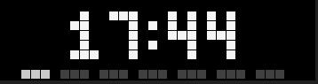
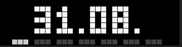
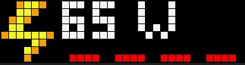
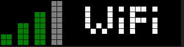
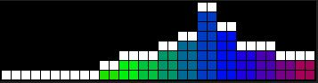
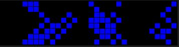
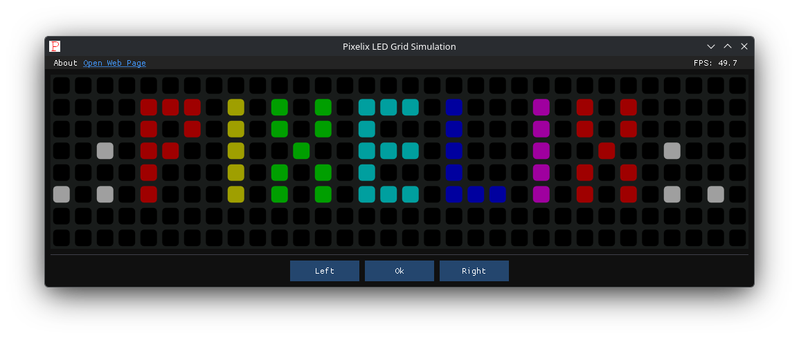

# PIXELIX <!-- omit in toc -->


An ESP32-powered information display for RGB LED matrices and selected TFT
screens. Show useful information at a glance, configure it from the web
interface, and integrate it with your smart home.

[](http://choosealicense.com/licenses/mit/)
[](https://www.home-assistant.io/integrations/mqtt)
[](https://www.repostatus.org/#wip)
[](https://github.com/BlueAndi/Pixelix/releases)
[](https://github.com/BlueAndi/Pixelix/actions/workflows/main.yml)

[](./doc/HOMEASSISTANT.md)\
[](https://makapix.club/)

[Install PIXELIX](#installation) · [Check supported hardware](./doc/boards/README.md) · [Connect Home Assistant](./doc/HOMEASSISTANT.md) · [Browse all documentation](./doc/README.md)

___

## Table of Contents <!-- omit in toc -->

- [What Is PIXELIX?](#what-is-pixelix)
- [What Can It Do?](#what-can-it-do)
- [Get Started](#get-started)
- [Supported Development Boards](#supported-development-boards)
- [Installation](#installation)
  - [Install A Prebuilt Release With The Web USB Installer](#install-a-prebuilt-release-with-the-web-usb-installer)
  - [Install A Prebuilt Release Manually](#install-a-prebuilt-release-manually)
  - [Build And Install The Software Yourself](#build-and-install-the-software-yourself)
  - [Verify The Installation](#verify-the-installation)
  - [Update A Running PIXELIX](#update-a-running-pixelix)
- [Very First Startup](#very-first-startup)
- [User Interface](#user-interface)
- [Integrations And Help](#integrations-and-help)
- [FAQ](#faq)
- [Used Libraries](#used-libraries)
- [Issues, Ideas And Bugs](#issues-ideas-and-bugs)
- [License](#license)
- [Contribution](#contribution)

## What Is PIXELIX?

PIXELIX turns an ESP32 board and an RGB LED matrix or small TFT into a
customizable information display. Show clocks, weather, sensor readings,
notifications, animations, and your own content. Configure the display from
its web interface; no cloud service is required.

PIXELIX can also connect to Home Assistant and other systems through MQTT and
REST. Its plugins let you choose what appears on the display and add new
content without changing the user interface.

## What Can It Do?

- Show static or scrolling text, icons, and animated GIFs. PNG and WebP support
  is available on boards with PSRAM.
- Display the time, weather, sensor readings, messages, and custom data.
- Configure display slots, brightness, and plugins in the web interface.
- Integrate with Home Assistant using MQTT discovery, the custom integration,
  or REST.
- Run on supported ESP32 boards with LED matrices or selected TFT displays.

### Display examples

| Time and date | Date display | Icon and text |
| --- | --- | --- |
|  |  |  |

| Sensor display | Wi-Fi status | OpenMeteoPlugin |
| --- | --- | --- |
|  |  |  |

| Sound reactive | Fire effect | Game of Life |
| --- | --- | --- |
|  |  |  |

### See PIXELIX in action

Click a preview to watch the video:

[](https://youtu.be/u1W9nlzJOI4 "PIXELIX & Friends")
[](https://youtu.be/dik8Rm6f3o0 "PIXELIX")
[](https://youtu.be/UCjJCI5JShY "PIXELIX - Remote Button")

### Develop with the native environment

You can also build and develop PIXELIX on Windows or Linux without an ESP32.
The native environment opens a simulated LED grid in a desktop window and
serves the web interface locally at `http://localhost:8080`.



Set up PlatformIO using the [toolchain guide](./doc/config/TOOLCHAIN-INSTALLATION.md),
then build the native environment with `platformio run --environment native`.

## Get Started

1. Check the [supported boards and displays](./doc/boards/README.md).
2. If your board and display match a release configuration, install a
   [prebuilt release](#install-a-prebuilt-release-with-the-web-usb-installer).
   No build toolchain is needed.
3. If you need a different matrix size, wiring, or plugin set, [build PIXELIX
   for your hardware](#build-and-install-the-software-yourself).
4. Follow the [first-startup guide](#very-first-startup) to connect it to Wi-Fi.

## Supported Development Boards

PIXELIX supports a range of ESP32 boards, LED matrices, and selected TFT
displays. The [board guide](./doc/boards/README.md) lists supported
combinations and pin connections. The [sensor guide](./doc/SENSORS.md) covers
compatible sensors and wiring.

The [Ulanzi TC001](https://www.ulanzi.com/products/ulanzi-pixel-smart-clock-2882)
is a ready-to-use option. For a custom build, 8 MB of flash or more and a
dual-core ESP32 are recommended; PSRAM enables additional image formats.

> **Power safety:** Do not power both the development board and LED matrix
> through USB. High LED current can damage the board. Use a suitably rated
> external 5 V supply and keep brightness within the software limit.

This [minimal wiring example](./doc/images/PixelixMinimalSetup.png) is based
on the ESP32 DevKit V1 and a 32×8 WS2812B panel. Wiring depends on the board
and display.

## Installation

PIXELIX can be installed in two different ways. Decide first which one applies to you, because it determines whether you need a build toolchain at all.

| Your situation                                                                                                                                                                                                                 | Way to go                                                                                                                                                                                                                                    |
| ------------------------------------------------------------------------------------------------------------------------------------------------------------------------------------------------------------------------------ | -------------------------------------------------------------------------------------------------------------------------------------------------------------------------------------------------------------------------------------------- |
| You use one of the [supported development boards](#supported-development-boards) with its standard display and the panel wiring matches.                                                                                       | Install a prebuilt release. No toolchain required, nothing needs to be compiled. Use the [web USB installer](#install-a-prebuilt-release-with-the-web-usb-installer) or [flash the binaries manually](#install-a-prebuilt-release-manually). |
| Your board/display combination is not released, your LED matrix size or panel topology is different, you want another set of plugins, you want to rotate the display by 180&deg; or you want to develop a plugin or fix a bug. | [Build and install the software yourself](#build-and-install-the-software-yourself).                                                                                                                                                         |

Every release provides ready-to-flash binaries for all supported board and display combinations. They are named after their build environment, e.g. ```esp32doit-devkit-v1-LED-32x8```, which encodes the development board as well as the display type and its resolution.

> :warning: A prebuilt binary has the LED matrix width/height, the panel topology and the list of plugins compiled in. None of them can be changed later in the web interface. If one of them does not match your hardware, you have to build the software yourself.

### Install A Prebuilt Release With The Web USB Installer

This is the easiest way and the recommended one for everybody who does not want to touch the source code. The installer runs completely in the browser, writes a full flash image (bootloader, partition table, factory image, firmware and filesystem) and can hand over the WiFi credentials over USB afterwards.

1. Open the [PIXELIX USB installer](https://blueandi.github.io/Pixelix/) in a Chromium based desktop browser, like Chrome, Edge, Opera or Brave. It is based on the Web Serial API, which is not available in Firefox, Safari or on mobile devices.
2. Choose the version. The latest stable release is preselected. All releases from version 11 on are offered; pre-releases are marked as such and are not recommended for productive use.
3. Choose your board and display configuration.
4. Connect the development board to your PC with a data capable USB cable and select the serial device once.
5. Start _Erase and install_. Note, that the flash is erased completely, which includes all settings of a previous installation.
    - To keep the settings of a previous installation, enable _Keep settings_ before. The flash is then not erased and the device settings stored in NVS survive: WiFi credentials, hostname, web login, brightness, timezone and so on. The slot configuration, MQTT, sensor calibration, timers and the plugin configuration are reset in any case, because they are part of the filesystem which is always written. Don't use it for the first installation on a board.
6. Keep the USB cable connected and continue with the WiFi setup on the same page. If that succeeds, you can skip the [Very First Startup](#very-first-startup).

If the board does not enter the download mode automatically, follow the BOOT/RESET sequence shown on the page. This is typically necessary for the ESP32 DevKit V1.

### Install A Prebuilt Release Manually

Use this way if no Chromium based browser is available or if you prefer the classic Espressif tools.

1. Download the binaries from the [latest release](https://github.com/BlueAndi/Pixelix/releases).
2. Write them to the flash with the Espressif Flash Download Tool (Windows only) or with esptool (any OS). The detailed steps, the required flash addresses and the flash layout are documented in [Upload/Update the software and the filesystem](./doc/config/SW-UPDATE.md).
3. Continue with the [Very First Startup](#very-first-startup).

See the [software update guide](./doc/config/SW-UPDATE.md#native-application) for native release downloads and installation.

### Build And Install The Software Yourself

> :information_source: The order matters. Configure the display **before** the first build, because the display configuration is compiled into the firmware.

1. Setup the [toolchain](./doc/config/TOOLCHAIN-INSTALLATION.md).
2. Configure your display in ```./config/display.ini```:
   - Adapt _CONFIG_LED_MATRIX_WIDTH_ and _CONFIG_LED_MATRIX_HEIGHT_ according to your LED matrix.
   - Change _CONFIG_LED_TOPO_ according to your physical panel topology. Take a look how your pixels are wired on the pcb and use the following page to choose the right one: [https://github.com/Makuna/NeoPixelBus/wiki/Layout-objects](https://github.com/Makuna/NeoPixelBus/wiki/Layout-objects)
   - Optional: set _CONFIG_DISPLAY_ROTATE180_ to 1 to [rotate the display by 180&deg;](./doc/FAQ.md#how-do-i-rotate-the-display-by-180-degrees).
3. Optional: adapt the [list of plugins](./doc/FAQ.md#how-do-i-configure-my-own-list-of-plugins) in the corresponding ```./config/config*.ini```.
4. [Build the software](./doc/config/SW-BUILD.md) and check whether the toolchain works.
5. [Upload the software and the filesystem](./doc/config/SW-UPDATE.md) to the target. Note, that both parts are necessary, the firmware and the filesystem image.
6. Continue with the [Very First Startup](#very-first-startup).

### Verify The Installation

Independent of the way you installed PIXELIX, verify that the LED panel topology is correct and that you see the "Hello World" on the display. If the text is mirrored, scrambled or spread over the wrong rows, the panel topology does not match and the software has to be built with the right _CONFIG_LED_TOPO_ setting.

### Update A Running PIXELIX

Once PIXELIX runs and its web interface is accessible, the firmware and the filesystem can be updated over WiFi with the PIXELIX Updater: [https://github.com/BlueAndi/PixelixUpdater](https://github.com/BlueAndi/PixelixUpdater). You can access the Updater through the submenu "Update" of PIXELIX's web interface. Reinstalling via USB is not necessary for an update.

## Very First Startup

When the device starts for the very first time, the WiFi station SSID and passphrase settings are empty. They can be configured in two possible ways:

1. Using the browser and set them in the captive portal.
2. Using a serial terminal connecting via USB.

### Variant 1: Configure WiFi station SSID and passphrase using a browser

As long as no WiFi station SSID and passphrase are configured, PIXELIX spawns a WiFi access point automatically on every startup. Just wait until it shows the SSID of the access point, search for it with your mobile device and connect.

Once the WiFi station SSID and passphrase are configured, PIXELIX connects to your WiFi network instead. To get back into the access point mode on purpose - e.g. after you replaced your router - restart the device and **keep the button pressed** until the access point SSID is shown.

- SSID: **pixelix-&lt;DEVICE-ID&gt;**
- Passphrase: **Luke, I am your father.**

Depending on your device, you may see a notification prompting you to open the captive portal. Otherwise, enter `http://192.169.4.1` in your browser's address bar.

Use the following default credentials to get access to the PIXELIX web interface:

- User: **luke**
- Password: **skywalker**

### Variant 2: Configure WiFi station SSID and passphrase using a serial terminal

Connect PIXELIX to your PC via USB and start a serial terminal. Use the following commands to set the WiFi SSID and passphrase of your home WiFi network:

- Write WiFi passphrase: ```write wifi passphrase <your-passphrase>```
- Write WiFi SSID: ```write wifi ssid <your-ssid>```
- Restart PIXELIX: ```restart```
- Get IP-address: ```get ip```
- Get hostname: ```get hostname```
- Get status: ```get status```
  - A status of 0 means everything is ok.
  - For any other status, see the [error code table](./doc/FAQ.md#the-display-shows-an-error-code-such-as-e4-what-does-it-mean). For example, status 1 corresponds to error code E1.

Use ```help``` to get a list of all supported commands.

### PIXELIX Is Ready

After configuration, restart PIXELIX. It will then be available on your Wi-Fi network.

To change what is displayed, open the web interface and use the same credentials as for the captive portal in Variant 1. On the **Display** page, configure it to suit your needs.

## User Interface

Pixelix can be controlled with buttons. Most of the development boards are supported with just one user button.

### One button control

- 1 short pulse: Activates the next slot.
- 2 short pulses: Activates the previous slot.
- 3 short pulses: Activates next fade effect.
- 4 short pulses: IP address is shown.
- 5 short pulses: Toggle display power on/off.
- Long pressed: Increases the display brightness until maximum and then decreases until minimum. After that it will again increases it and so on.

### Two button control (LILYGO&reg; T-Display ESP32-S3)

- Left button:
  - 1 short pulses: Activates the previous slot.
  - 2 short pulses: Toggle display power on/off.
  - Long pressed: Decreases the display brightness until minimum.
- Right button
  - 1 short pulse: Activates the next slot.
  - 2 short pulses: Activates next fade effect.
  - 3 short pulses: IP address is shown.
  - Long pressed: Increases the display brightness until maximum.

### Three button control (Ulanzi TC001)

- Left button:
  - 1 short pulses: Activates the previous slot.
  - Long pressed: Decreases the display brightness until minimum.
- Ok button:
  - 1 short pulses: Activates next fade effect.
  - 2 short pulses: IP address is shown.
  - Long pressed: Toggle display power on/off.
- Right button
  - 1 short pulse: Activates the next slot.
  - Long pressed: Increases the display brightness until maximum.

### Remote button

If the display's location is hard to reach, the remote user button feature can be used. It is controllable via REST API and perfect for remote buttons like the [Shelly Button 1](https://shelly.cloud/products/shelly-button-1-smart-home-automation-device/).

## Integrations And Help

- [Home Assistant](./doc/HOMEASSISTANT.md)
- [REST API](https://app.swaggerhub.com/apis/BlueAndi/Pixelix/1.10.0)
- [MQTT API](./doc/MQTT.md)
- [Available plugins](./doc/PLUGINS.md)
- [Frequently asked questions](./doc/FAQ.md)
- [All user guides and developer references](./doc/README.md)

## FAQ

Find answers to common questions in the [PIXELIX FAQ](./doc/FAQ.md).

## Used Libraries

The complete list, including license information, is in the
[third-party library reference](./doc/USED-LIBRARIES.md).

## Issues, Ideas And Bugs

If you have ideas or found a bug, create an [issue](https://github.com/BlueAndi/Pixelix/issues). If you want to fix it yourself, clone the repository and open a pull request. For questions to the community or showing the own Pixelix, the [Discord server](https://discord.gg/D3uYhBQBhf) can be used.

## License

The whole source code is published under the [MIT license](http://choosealicense.com/licenses/mit/).
Third-party library licenses are listed in the [library reference](./doc/USED-LIBRARIES.md).

## Contribution

Unless you explicitly state otherwise, any contribution intentionally submitted for inclusion in the work by you, shall be licensed as above, without any
additional terms or conditions.
