# PIXELIX <!-- omit in toc -->


[](http://choosealicense.com/licenses/mit/)

## Alternative Icons <!-- omit in toc -->

- [Purpose](#purpose)
- [Supported Image Formats](#supported-image-formats)
- [OpenWeatherPlugin](#openweatherplugin)
  - [Color Intense](#color-intense)
  - [Colorless](#colorless)
  - [Animated](#animated)
- [Others](#others)
  - [BTC Quote](#btc-quote)
- [Issues, Ideas And Bugs](#issues-ideas-and-bugs)
- [License](#license)
- [Contribution](#contribution)

## Purpose

In order to use alternative icons for plugins you simply have to replace the respective ```<iconName>.bmp``` or ```<iconName>.gif``` in the corresponding plugin folder. All plugins can be found in ```/lib/<PLUGIN-NAME>``` and their icons in ```/lib/<PLUGIN-NAME>/web```.

During building the filesystem image they will be automatically grabbed.

**Note** the name of the respective icon must not be changed!

In the following you find all available alternative icons classified according to plugin.

## Supported Image Formats

Every Pixelix board supports `.bmp` and `.gif` for icons and uploaded images. This
is the historical feature set and does not depend on the board.

`.png` and `.webp` (static and animated) are supported in addition, but **only on
boards which have PSRAM**. PNGdec, the PNG decoder, and libwebp, the WebP
decoder, both need more RAM and flash than fits the 4 MB boards this project
also supports, so the two formats are compiled in only where there is PSRAM to
spend. The icon page of a board without PSRAM therefore only offers `.bmp` and
`.gif`, and an upload of a `.png` or `.webp` file is refused.

The environments built with PNG and WebP support are:

- `adafruit_matrixportal_s3-HUB75-64x64`
- `adafruit_matrixportal_s3-HUB75-64x64-makapix`
- `esp32-s3-devkitc-1-n16r8v-LED-32x8`
- `esp32-s3-devkitc-1-n16r8v-LED-32x16`
- `lilygo-t-display-s3-TFT-32x8`
- `lilygo-t-display-s3-TFT-64x16`
- `lilygo-t-display-s3-TFT-64x16-makapix`
- `native` (the host simulator)

Every other environment in [platformio.ini](../platformio.ini) builds with
`.bmp` and `.gif` only.

A few PNG files will be refused even on a board which has both formats, and
knowing why saves a round trip to the device log:

- **Interlaced (Adam7) PNGs are refused.** Interlacing is a checkbox in many
  export dialogs, and PNGdec does not support it.
- **16 bit per sample PNGs are refused.** Only 1, 2, 4 and 8 bit per sample are
  decoded.
- **A wide PNG with an alpha channel is refused as "too big", well below any
  practical icon size.** This is not a Pixelix size policy; it works around a
  line-buffer overflow inside PNGdec itself. Depending on the pixel format, the
  width at which this kicks in is roughly: 317 px for truecolor with alpha, 422
  px for truecolor, 633 px for gray with alpha, 1266 px for 8 bit grayscale or
  indexed. The largest display this firmware drives is 64 px wide, so an
  ordinary icon is never affected — only an unusually large image uploaded by
  mistake.
- An animated WebP is shown with the loop count the file itself carries; an
  animated GIF always loops forever, which is a visible difference if the same
  loop count is intended for both.

## OpenWeatherPlugin

### Color Intense

|                                                                             |                                                                             |                                                                             |                                                                             |
| --------------------------------------------------------------------------- | --------------------------------------------------------------------------- | --------------------------------------------------------------------------- | --------------------------------------------------------------------------- |
| 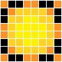 | 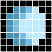 | 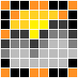 | 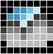 |
| 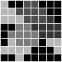   | 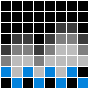   | 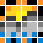 | 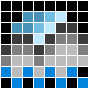 |
|    | 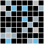   | 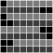   |                                                                             |

Find them here: [./images/icons/OpenWeatherPluginColorIntense/](./images/icons/OpenWeatherPluginColorIntense/)

Notes:

* Only 8x8 icons available.

Designed by [NSD4rKn3SS](https://github.com/NSD4rKn3SS)

### Colorless

|                                                                          |                                                                          |                                                                          |                                                                          |
| ------------------------------------------------------------------------ | ------------------------------------------------------------------------ | ------------------------------------------------------------------------ | ------------------------------------------------------------------------ |
| 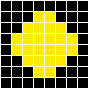 | 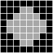 |  |  |
|    |    | 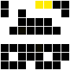 | 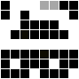 |
|    |    |    |                                                                          |

Find them here: [./images/icons/OpenWeatherPluginColorLess](./images/icons/OpenWeatherPluginColorLess/)

Designed by [BlueAndi](https://github.com/BlueAndi)

### Animated

|                                                                         |                                                                         |                                                                         |                                                                         |
| ----------------------------------------------------------------------- | ----------------------------------------------------------------------- | ----------------------------------------------------------------------- | ----------------------------------------------------------------------- |
| 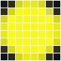 |  | 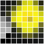 |  |
| 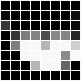   | 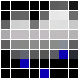   | 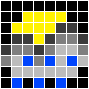 | 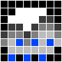 |
| 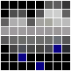   | 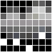   | 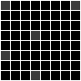   |                                                                         |

Find them here: [./images/icons/OpenWeatherPluginAnimated/](./images/icons/OpenWeatherPluginAnimated/)

Notes:

* Only 8x8 icons available.

Designed by [ddijanic](https://github.com/ddijanic)

## Others

### BTC Quote

| Name                    | Author                                      | Preview                                                                    | Location                                                                     |
| ----------------------- | ------------------------------------------- | -------------------------------------------------------------------------- | ---------------------------------------------------------------------------- |
| BTC Quote               | [flcu](https://github.com/flcu)             | 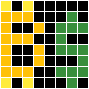             | [./images/icons/BTCQuote/](./images/icons/BTCQuote/)                         |
| BTC Quote Color Intense | [NSD4rKn3SS](https://github.com/NSD4rKn3SS) | 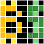 | [./images/icons/BTCQuoteColorIntense/](./images/icons/BTCQuoteColorIntense/) |

## Issues, Ideas And Bugs

If you have ideas or found a bug, create an [issue](https://github.com/BlueAndi/Pixelix/issues). If you want to fix it yourself, clone the repository and open a pull request.

## License

The whole source code is published under the [MIT license](http://choosealicense.com/licenses/mit/).
Consider the different licenses of the used third party libraries too!

## Contribution

Unless you explicitly state otherwise, any contribution intentionally submitted for inclusion in the work by you, shall be licensed as above, without any
additional terms or conditions.
