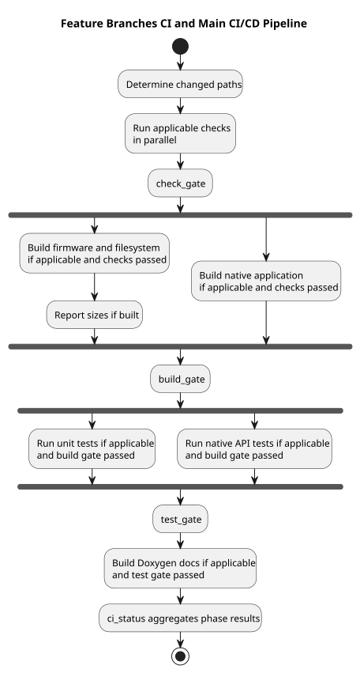
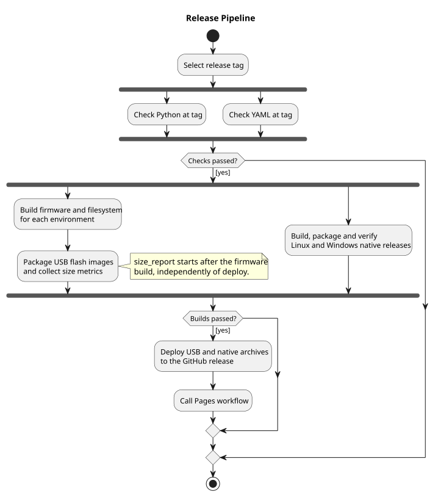
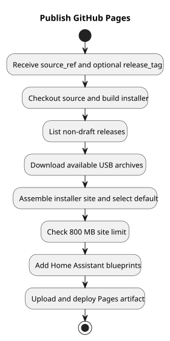
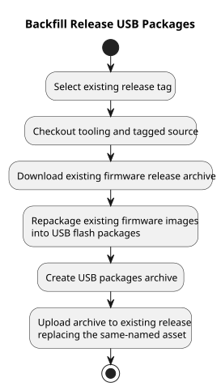

# CI and release workflows

Pixelix uses GitHub Actions for change-sensitive CI, release packaging and
publication. The definitions in [`.github/workflows`](../.github/workflows/) are
the source of truth; this document describes their current behavior.

| Workflow | Trigger | Purpose |
| --- | --- | --- |
| [Feature Branches CI](../.github/workflows/featureBranches.yml) | Push to `Development`, pull request targeting any branch except `master` or `main`, or manual dispatch | Check and build integration and feature changes. |
| [Main CI/CD Pipeline](../.github/workflows/main.yml) | Push or pull request targeting `master` or `main`, published release, or manual dispatch | Validate changes and refresh main-branch build baselines. |
| [Release Pipeline](../.github/workflows/release.yml) | Manual dispatch with `tag_name` | Build and publish release assets, then invoke Pages. |
| [Publish GitHub Pages](../.github/workflows/pages.yml) | Called by Release Pipeline or manually dispatched | Publish the web installer and Home Assistant blueprints. |
| [Backfill Release USB Packages](../.github/workflows/backfill-usb-packages.yml) | Manual dispatch with an existing `tag_name` | Add USB flash packages to an existing release. |

## Feature and main CI



[PlantUML source](./workflows/uml/ci_pipeline.wsd)

The two CI workflows use the same staged structure. Jobs in a stage can run
in parallel, but applicable later work waits for the preceding gate:

1. **Changes:** `changes` uses `dorny/paths-filter` to classify changed paths.
   Manual dispatch bypasses filtering and enables all applicable jobs; a
   published release also bypasses filtering in Main CI.
2. **Check:** `check` runs PlatformIO static analysis for nine representative
   environments and fails on medium or high defects. `check_format` runs
   clang-format on C/C++ files under `src`, `lib` and `include`, excluding
   bundled imgui and libwebp. `check_python` runs full Pylint on tracked Python
   files, except the two context-dependent skill templates. `openapi_lint`
   validates the OpenAPI specification; `check_yaml` checks tracked YAML syntax
   and duplicate keys. `check_gate` waits for these jobs.
3. **Build:** `build` compiles firmware and builds filesystem images for 16
   environments. It uploads per-environment size metrics; `size_report`
   compares them with available previous runs and writes a workflow summary.
   In parallel, `build_native` builds the Linux native application, bundles its
   non-system runtime libraries and uploads a short-lived artifact.
   `build_gate` waits for both builds and the size report.
4. **Test:** `test` runs the PlatformIO `test` environment. In parallel,
   `native_api_test` downloads the native artifact, exercises the captive
   portal and web server, and uses Schemathesis to check selected positive
   REST API cases against the OpenAPI specification. `test_gate` waits for
   both tests.
5. **Doc:** `doc` builds Doxygen documentation with Graphviz. `ci_status`
   aggregates the gates and documentation result into a final status.

The gate jobs run even when individual jobs were skipped. They fail on a
dependency result of `failure` or `cancelled`; a skipped job alone does not
fail a gate. GitHub's normal dependency-success rules prevent later work after
a failed gate. The diagram shows the intended stage order; each action marked
“if applicable” can be skipped.

### Change filters

The following is a summary, not a substitute for the exact glob patterns in
the workflow definitions. A single change can enable several categories.

| Filter | Principal paths | Jobs enabled |
| --- | --- | --- |
| `firmware` | Firmware sources, headers, configuration, web data, partition tables, `platformio.ini` and selected build scripts | `build`, then `size_report` |
| `static` | Sources, headers, configuration and `platformio.ini` | `check` |
| `format` | Sources, headers and `.clang-format` | `check_format` |
| `python` | Python files and `.pylintrc` | `check_python` |
| `openapi` | `doc/OpenAPI` | `openapi_lint` |
| `yaml` | `*.yml` and `*.yaml` | `check_yaml` |
| `tests` | Tests, sources, headers, configuration and selected build scripts | `test` |
| `native` | Sources, headers, configuration, web data, OpenAPI and selected scripts | `build_native` and `native_api_test` |
| `docs` | Sources, headers and `doc/doxygen` | `doc` |

For example, a Markdown-only change outside these paths does not cause a
firmware build or Doxygen job. The exact filter list matters: the workflows do
not infer dependencies from arbitrary file contents.

### Differences and resource usage

- Feature CI runs on `Development` pushes and on pull requests not targeting
  `master`/`main`. A feature branch without a pull request can be checked
  manually. Main CI covers pull requests to `master`/`main`.
- On a `master`/`main` **push**, Main CI skips its checks, native build, tests
  and Doxygen job, but can build firmware and report sizes when the firmware
  filter matches. Pull requests, manual runs and published-release events can
  run the full applicable pipeline. Feature CI does not have this push
  exclusion.
- Both workflows cancel superseded pull-request runs in the same concurrency
  group. Push and manual runs are not cancelled by that rule.
- PlatformIO packages and pip downloads are cached using the PlatformIO
  version, cache epoch and configuration hash. Firmware build folders are
  restored per environment and saved on push runs. The native build tries
  the runner's SDL3 package first; otherwise it builds and caches SDL3.
- Size reports use current metrics artifacts and attempt to retrieve previous
  successful run artifacts. Feature pull requests can compare both the source
  and target branch; missing or unavailable baseline artifacts do not prevent
  the report from being produced.

## Release Pipeline



[PlantUML source](./workflows/uml/release_pipeline.wsd)

Start this workflow manually and provide the tag to release. Runs for the same
tag are serialized rather than cancelling each other. It checks out that tag
for Pylint and YAML checks, then starts the firmware and native builds in
parallel only after both checks succeed. This workflow does **not** run the
full staged Main CI checks and tests itself.

- Firmware is built from the tag for the 16-environment matrix. The workflow
  generates sources, builds firmware and filesystem images, packages USB flash
  images and uploads size metrics. PlatformIO packages are cached, but build
  folders are not restored: release builds are clean.
- Native Linux x86-64 and Windows x86-64 archives are built, packaged and
  verified on their respective operating systems. Release source comes from
  the requested tag; native packaging tools are checked out from the workflow
  run's commit.
- `size_report` starts after the firmware build and compares available metrics
  with a previous successful release run. It is **not** a dependency of
  `deploy`: a report failure does not itself block publishing assets.
- `deploy` requires successful firmware and native builds, downloads their
  artifacts, creates the combined USB archive and publishes it together with
  the native archives to the selected GitHub release.
- After deployment, `publish_installer` calls the Pages workflow with the
  release tag as `source_ref`. It does not pass `release_tag`, so Pages uses
  its default-release selection rather than necessarily selecting this tag.

Publishing a release also triggers the separate Main CI workflow; that
workflow is not a prerequisite of Release Pipeline's `deploy` job.

## Publish GitHub Pages



[PlantUML source](./workflows/uml/pages_pipeline.wsd)

The reusable workflow requires `source_ref`, the branch or tag used to build
the frontend. A manual run defaults this to `Development`; `release_tag` is
optional and selects the preselected installer release. When it is empty, the
installer chooses the latest stable release, or the latest pre-release when
no stable release exists.

The workflow builds the installer with Node.js, lists up to 200 non-draft
releases, downloads available USB package archives, and assembles the site.
Releases without the archive are skipped. It fails if the assembled site
exceeds 800 MB, copies the Home Assistant blueprints into the site, then
uploads and deploys a Pages artifact. Deployments share a concurrency group
and are serialized.

## Backfill Release USB Packages



[PlantUML source](./workflows/uml/backfill_pipeline.wsd)

For an existing release, manually supply its tag. The workflow checks out
current backfill tooling and the tagged source separately, downloads the
existing `<repository>-<tag>.zip` release archive, repackages its firmware
images using the tagged project configuration, and uploads
`<repository>-<tag>-usb-flash-packages.zip`. An existing asset with the same
name is replaced. This workflow does not rebuild firmware or publish Pages;
run the Pages workflow separately if the installer should pick up the new
asset.

## Diagram maintenance

PlantUML sources are in [`workflows/uml`](./workflows/uml/), and the rendered
SVGs used above are in [`workflows/svg`](./workflows/svg/). Regenerate an SVG
after editing its source, using PlantUML with Graphviz, for example:

```text
java -jar plantuml.jar -tsvg doc/workflows/uml/*.wsd -o ../svg
```

Keep the diagrams and this description synchronized with the workflow YAML.
