# PIXELIX <!-- omit in toc -->

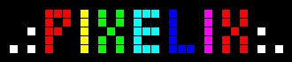

[](http://choosealicense.com/licenses/mit/)

## Component Details <!-- omit in toc -->

This document complements the [SW architecture](README.md) with the component level design. Read the architecture first; it explains the layers, the service concept and the plugin concept which the components below fit into.

- [Hardware Abstraction Layer](#hardware-abstraction-layer)
- [Graphic Base Functionality](#graphic-base-functionality)
- [Widgets](#widgets)
- [User Button Handling](#user-button-handling)
- [Audio Service](#audio-service)
  - [Spectrum Analyzer](#spectrum-analyzer)
- [HTTP And REST Service](#http-and-rest-service)
  - [GET Request](#get-request)
  - [Service Stop](#service-stop)
  - [Plugin Stop](#plugin-stop)
- [MQTT Service](#mqtt-service)
- [Timer Service](#timer-service)
- [Topic Model Reference](#topic-model-reference)
- [Issues, Ideas And Bugs](#issues-ideas-and-bugs)
- [License](#license)
- [Contribution](#contribution)

## Hardware Abstraction Layer

The `Board` is a singleton which owns the common ESP32 drivers and exactly one display driver. Which display driver is compiled in is decided by the board environment at build time.

The sensors are a C++ namespace of independent classes. Each one realizes `ISensor` and offers its measurements as typed sensor channels. `SensorDataProvider` in the application layer is the only consumer.

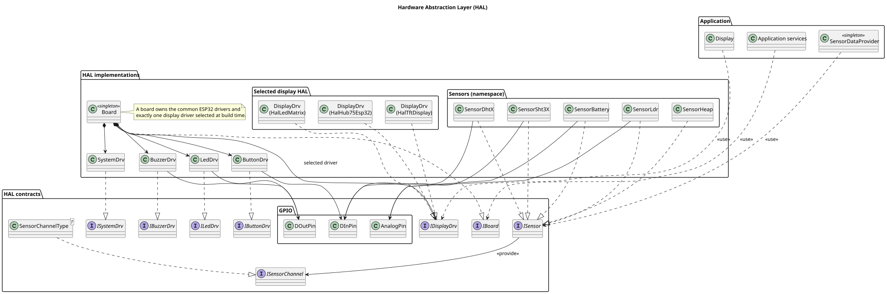

## Graphic Base Functionality

The graphics stack is a template hierarchy which is independent of the concrete color type. `YAGfx` binds it to the project color type:

```cpp
using YAGfx = BaseGfx<Color>;
```

`IDisplay` is an abstract class which *is a* `YAGfx`, so anything which can draw into a graphics context can draw into the display. `Display` implements it for the physical display and forwards to the selected HAL display driver.

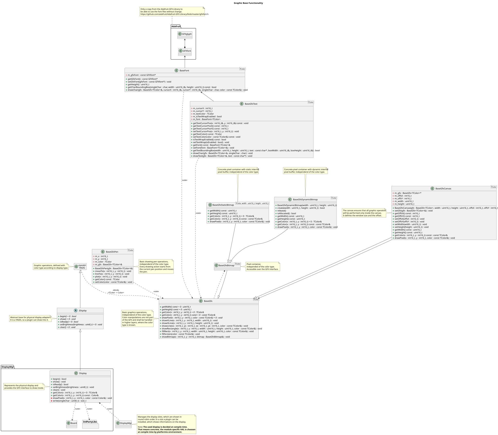

## Widgets

A widget owns a canvas and draws itself into it. The base class provides the common functionality, which is the width, height and the position inside the parent canvas. Only `paint()` is left to the concrete widget.

`CanvasWidget` is a widget and a graphics context at the same time, so other widgets can be nested inside it.

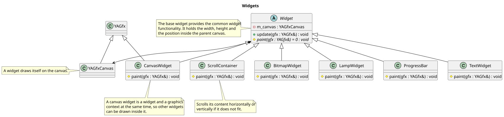

## User Button Handling

The ISR only reports that a button edge was detected. Every edge restarts the debounce timer of that button. The button task evaluates the pin level once the timer expired, which means the level was stable for `DEBOUNCING_TIME` (100 ms). Only a state change notifies the observer.

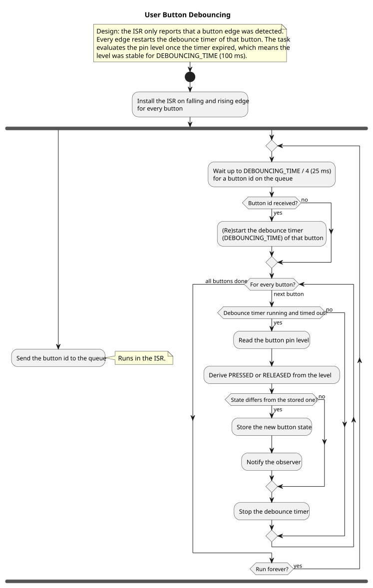

## Audio Service

`AudioService` starts and stops the audio driver and provides the spectrum analyzer and the tone detector instances to the plugins. `AudioDrv` reads the I2S samples and notifies its observers once a full sample buffer is available.

Several plugins may use the audio service at the same time. Be aware that every plugin may reconfigure the tone detectors, so they are shared state.

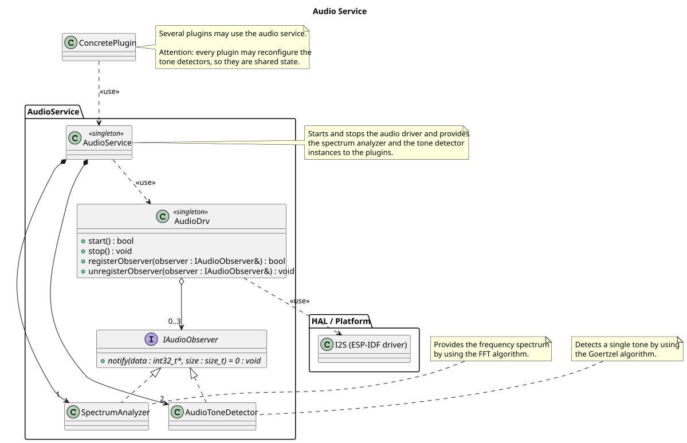

### Spectrum Analyzer

The audio driver task runs on the other ESP32 core for load sharing. It reads one DMA block per `I2S_EVENT_RX_DONE` event and notifies the observers once the sample buffer is full.

| Parameter | Value |
| --------- | ----- |
| I2S port | `I2S_NUM_0` |
| Sample rate | 14080 Hz |
| Bits per sample | 32 |
| Samples per FFT run | 512 |
| DMA block size | 256 byte (64 samples) |
| DMA blocks | 4 |

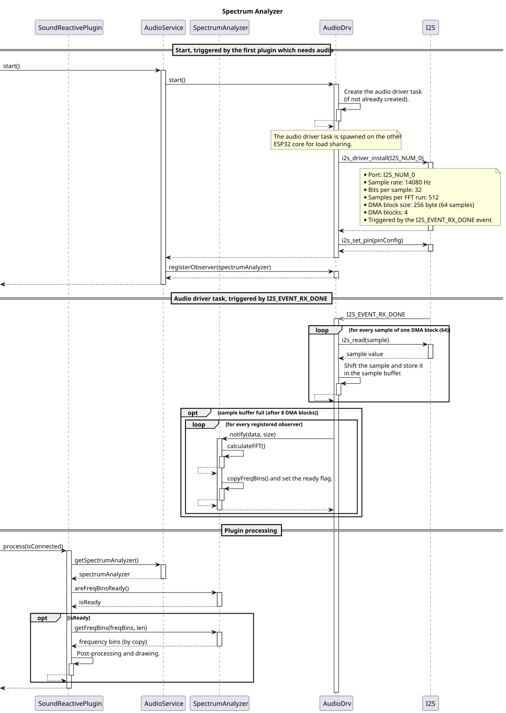

## HTTP And REST Service

Two services cooperate to keep blocking network I/O out of the loop task:

- `HttpService` owns a worker task (`HttpSrvWork`) which performs the blocking `HTTPClient` call. It supports HTTP and HTTPS and handles multiple jobs sequentially.
- `RestService` sits on top and decouples a plugin from the transport. A plugin queues a request and immediately receives a `restId`. The service executes one request at a time and stores the parsed response until the plugin picks it up.

The JSON parsing happens in a plugin supplied pre-process callback, so only the data a plugin really needs is kept in memory.

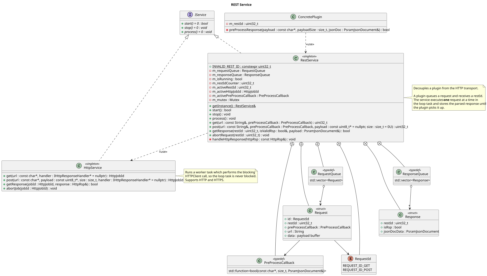

### GET Request

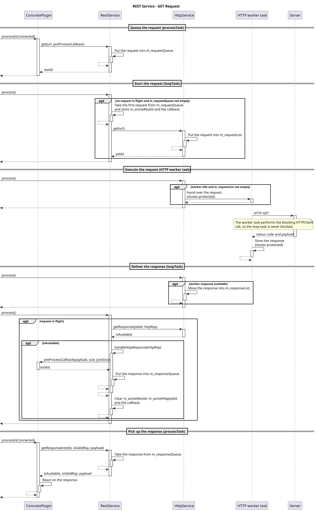

### Service Stop

While the service is stopped it accepts no new request and delivers no response. Once `getResponse()` returned false, the plugin resets its own request state and stays in a safe state until the service is started again.

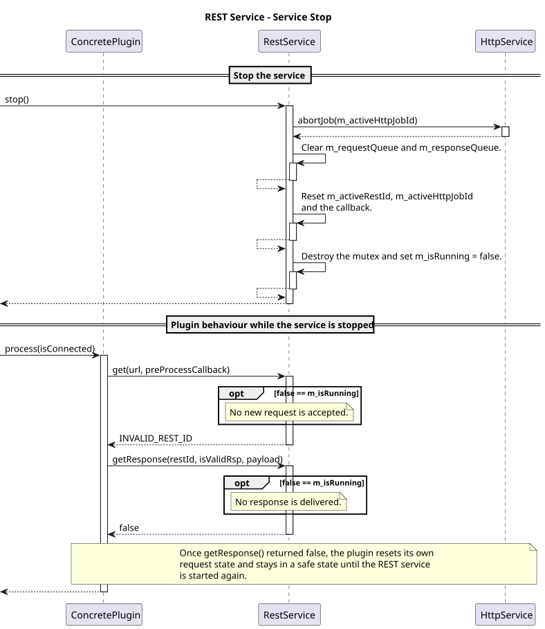

### Plugin Stop

A plugin aborts its pending request on `stop()`. The request may be waiting in the request queue, in flight at the `HttpService`, or already answered and waiting in the response queue; all three cases are handled.

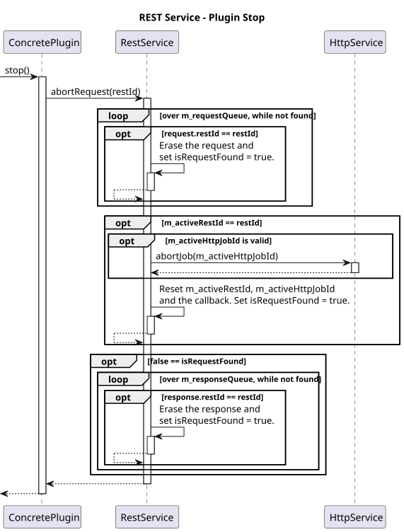

## MQTT Service

`MqttService` manages the MQTT broker connectivity and the topic I/O. It loads `/configuration/mqttService.json` and creates the broker connections.

Each broker connection runs a small state machine (`IDLE`, `DISCONNECTED`, `CONNECTED`) with reconnect timer handling, optional TLS client setup (`WiFiClientSecure`), MQTT birth and last-will messages, and automatic resubscription after a reconnect.

The service registers its own settings topic (`mqttService/mqtt`) lazily in `process()`, to be sure the topic handlers are already started.

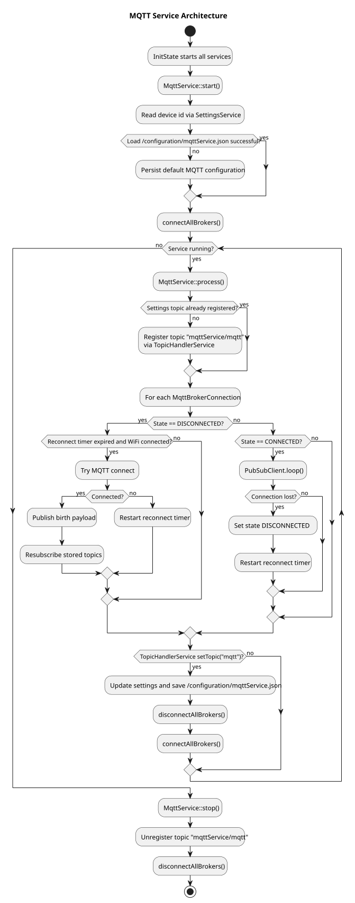

## Timer Service

`TimerService` implements scheduled display control with persisted timer rules. It loads `/configuration/timerService.json`, registers the topic `timerService/timer` at the `TopicHandlerService`, and evaluates up to 8 timer entries every 100 ms.

If a rule signals, it triggers `DisplayMgr::displayOn()`, `DisplayMgr::displayOff()` and/or `DisplayMgr::setBrightness()`.

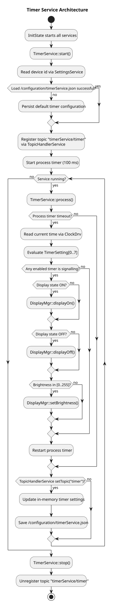

## Topic Model Reference

The two diagrams below are mind maps, not UML. They document the topic model and the MQTT namespace as a reference.

See also [../MQTT.md](../MQTT.md) for the API documentation and [../HOMEASSISTANT.md](../HOMEASSISTANT.md) for the Home Assistant discovery.

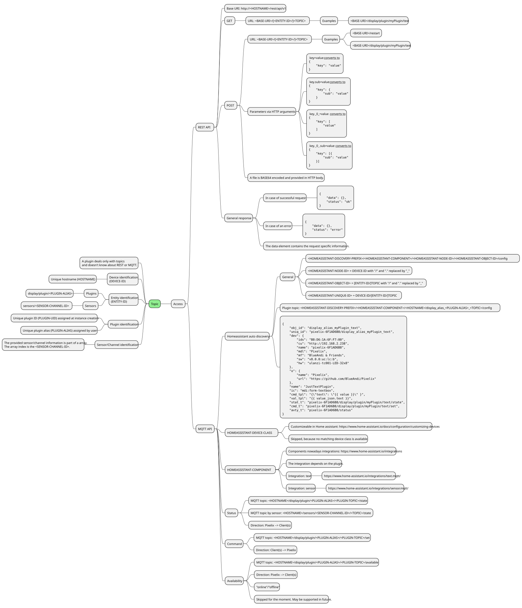

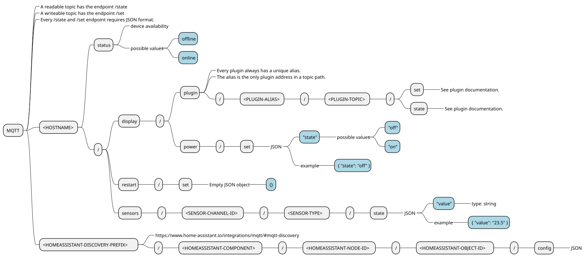

## Issues, Ideas And Bugs

If you have ideas or found a bug, create an [issue](https://github.com/BlueAndi/Pixelix/issues). If you want to fix it yourself, clone the repository and open a pull request.

## License

The whole source code is published under the [MIT license](http://choosealicense.com/licenses/mit/).
Consider the different licenses of the used third party libraries too!

## Contribution

Unless you explicitly state otherwise, any contribution intentionally submitted for inclusion in the work by you, shall be licensed as above, without any
additional terms or conditions.
