# PIXELIX <!-- omit in toc -->


[](http://choosealicense.com/licenses/mit/)

## SW Architecture <!-- omit in toc -->

- [Purpose](#purpose)
- [Scope](#scope)
- [Context](#context)
  - [Reference Hardware](#reference-hardware)
- [Deployment](#deployment)
- [Layers](#layers)
  - [Application Layer](#application-layer)
  - [Service Layer](#service-layer)
  - [Hardware Abstraction Layer](#hardware-abstraction-layer)
- [Services](#services)
  - [Service Interface And Facade](#service-interface-and-facade)
  - [Service Lifecycle](#service-lifecycle)
  - [Service Catalogue](#service-catalogue)
  - [Topic Handling](#topic-handling)
- [Plugin Concept](#plugin-concept)
  - [Static View](#static-view)
  - [Install And Uninstall](#install-and-uninstall)
  - [Configuration Handling](#configuration-handling)
  - [Slot Scheduling](#slot-scheduling)
- [Runtime Behaviour](#runtime-behaviour)
  - [System Startup](#system-startup)
  - [System States](#system-states)
- [Component Details](#component-details)
- [Diagram Sources](#diagram-sources)
- [Issues, Ideas And Bugs](#issues-ideas-and-bugs)
- [License](#license)
- [Contribution](#contribution)

## Purpose

The SW architecture provides an overview of the relationships between the different components of PIXELIX. It serves for understanding, maintaining, fixing and extending the software.

Two ideas shape the whole design:

- **Everything long-lived is a service.** A service implements the `IService` lifecycle (`start()`, `process()`, `stop()`) and is orchestrated by a generated facade. See [Services](#services).
- **Everything visible is a plugin.** A plugin is a self-contained display unit which is installed into a slot, scheduled by the display manager and exposed over REST and MQTT through a single topic model. See [Plugin Concept](#plugin-concept).

## Scope

This document is valid for the PIXELIX firmware. It describes the architecture, not the implementation of a single component.

Out of scope and covered elsewhere:

| Topic | Document |
| ----- | -------- |
| Component level design (graphics, widgets, audio, REST, MQTT, timers) | [DETAILS.md](DETAILS.md) |
| How to write a plugin | [../PLUGIN-DEV.md](../PLUGIN-DEV.md) |
| What each plugin does | [../PLUGINS.md](../PLUGINS.md) |
| MQTT and WebSocket API | [../MQTT.md](../MQTT.md), [../WEBSOCKET.md](../WEBSOCKET.md) |
| Home Assistant integration | [../HOMEASSISTANT.md](../HOMEASSISTANT.md) |
| Supported boards | [../boards](../boards) and [platformio.ini](../../platformio.ini) |

## Context

PIXELIX is not a complete system on its own. It interacts with neighbour systems over physical and logical interfaces.

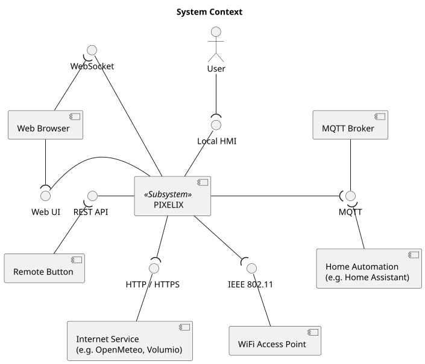

PIXELIX **provides** the local HMI (display and buttons), the web UI, the REST API and the WebSocket interface. It acts as a **client** towards the WiFi access point, the MQTT broker and any internet service a plugin pulls its data from.

### Reference Hardware

The diagram below shows the hardware of the original design. Many more boards are supported; the display driver and the pin assignment are selected at build time.

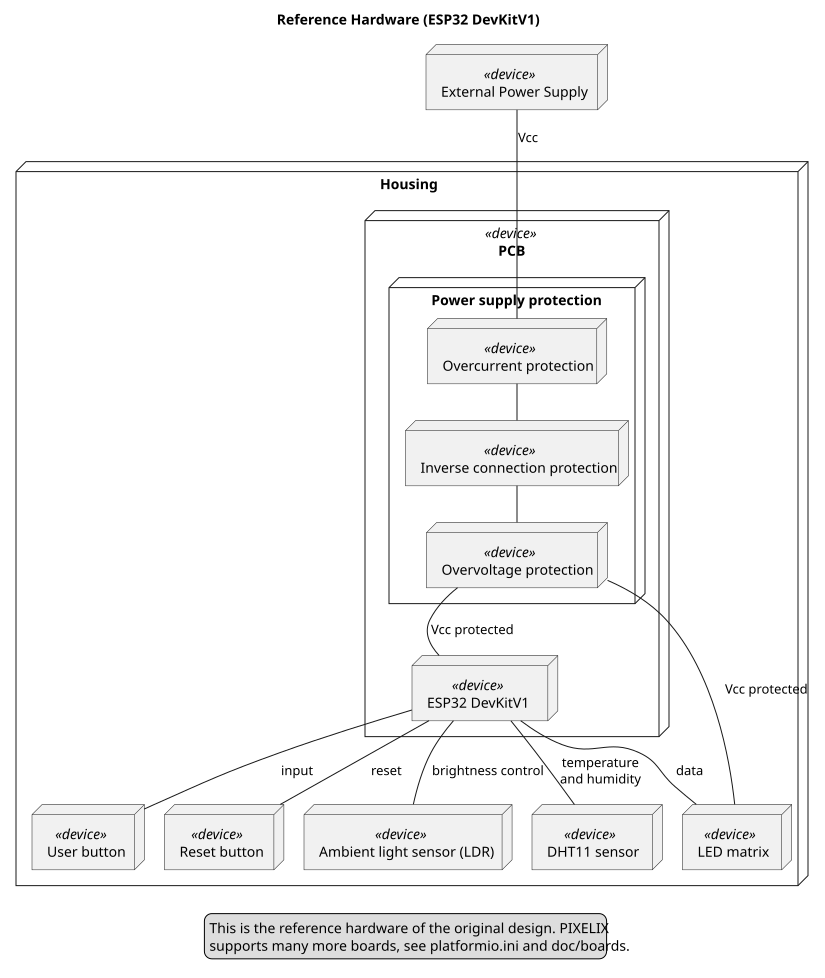

## Deployment

PIXELIX runs on the dual core ESP32 derivates. A FreeRTOS task is modelled as an artifact, deployed on the execution environment which schedules it.

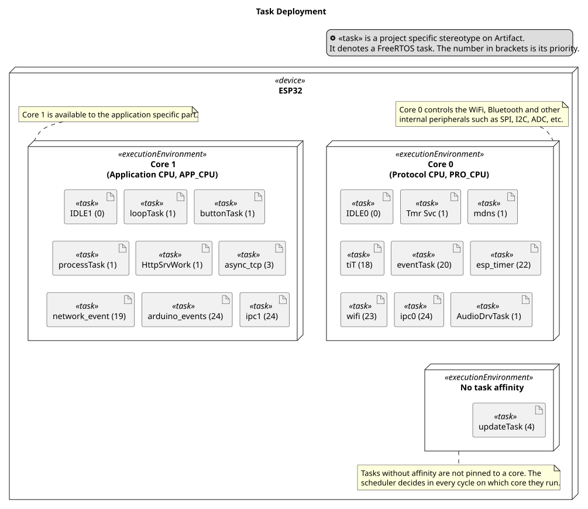

| Task name            | Core        | Description                                                                                                                                                                                                                                              |
| -------------------- | ----------- | -------------------------------------------------------------------------------------------------------------------------------------------------------------------------------------------------------------------------------------------------------- |
| arduinoEvents        | APP_CPU     | WiFi handling, see details in Arduino framework WiFiGeneric.cpp                                                                                                                                                                                          |
| async_tcp            | PRO_CPU     | AsyncTCPSock library uses the task to interact with the LwIP TCP/IP stack and the application.                                                                                                                                                           |
| AudioDrvTask         | PRO_CPU     | The audio driver receives the I2S samples via DMA and notifies its observers. It runs on the other core for load sharing.                                                                                                                                |
| buttonTask           | APP_CPU     | The task is triggered by a hardware button and provides its status.                                                                                                                                                                                      |
| esp_timer            | PRO_CPU     | [High resolution timer](https://docs.espressif.com/projects/esp-idf/en/latest/esp32/api-reference/system/esp_timer.html#high-resolution-timer) task, which calls the timer callbacks.                                                                    |
| eventTask            | PRO_CPU     | Internal [event loop library](https://docs.espressif.com/projects/esp-idf/en/latest/esp32/api-reference/system/esp_event.html#event-loop-library) task of ESP-IDF. It dispatches posted system events (e.g. WiFi/TCP-IP) to registered handlers.         |
| HttpSrvWork          | APP_CPU     | Worker task of the `HttpService`. It performs the blocking HTTPClient call, so the loop task is never blocked.                                                                                                                                           |
| IDLE0                | PRO_CPU     | Idle task created for CPU 0. See [FreeRTOS applications](https://docs.espressif.com/projects/esp-idf/en/latest/esp32/api-reference/system/freertos.html#esp-idf-freertos-applications).                                                                  |
| IDLE1                | APP_CPU     | Idle task created for CPU 1. See [FreeRTOS applications](https://docs.espressif.com/projects/esp-idf/en/latest/esp32/api-reference/system/freertos.html#esp-idf-freertos-applications).                                                                  |
| ipc0                 | PRO_CPU     | IPC task created for CPU 0. IPC tasks are used to implement the Inter-Processor-Call feature. See [FreeRTOS applications](https://docs.espressif.com/projects/esp-idf/en/latest/esp32/api-reference/system/freertos.html#esp-idf-freertos-applications). |
| ipc1                 | APP_CPU     | IPC task created for CPU 1. IPC tasks are used to implement the Inter-Processor-Call feature. See [FreeRTOS applications](https://docs.espressif.com/projects/esp-idf/en/latest/esp32/api-reference/system/freertos.html#esp-idf-freertos-applications). |
| loopTask             | APP_CPU     | The standard Arduino loop task. It calls `setup()` once and periodically `loop()`. The system state machine and `Services::processAll()` run here.                                                                                                       |
| mdns                 | PRO_CPU     | mDNS (multicast UDP) service.                                                                                                                                                                                                                            |
| network_event        | APP_CPU     | The task processes system events, e.g. WiFi and TCP/IP events. See [event loop library](https://docs.espressif.com/projects/esp-idf/en/latest/esp32/api-reference/system/esp_event.html#event-loop-library) for more information.                        |
| processTask          | APP_CPU     | The DisplayMgr processes the plugins in this task.                                                                                                                                                                                                       |
| tiT                  | PRO_CPU     | The LwIP TCP/IP stack task.                                                                                                                                                                                                                              |
| Tmr Svc              | PRO_CPU     | FreeRTOS timer service.                                                                                                                                                                                                                                  |
| updateTask           | no-affinity | The DisplayMgr updates the physical display there.                                                                                                                                                                                                       |
| wifi                 | PRO_CPU     | WiFi handling.                                                                                                                                                                                                                                           |

## Layers

A layer may only use the layers below it. There is no upward dependency.

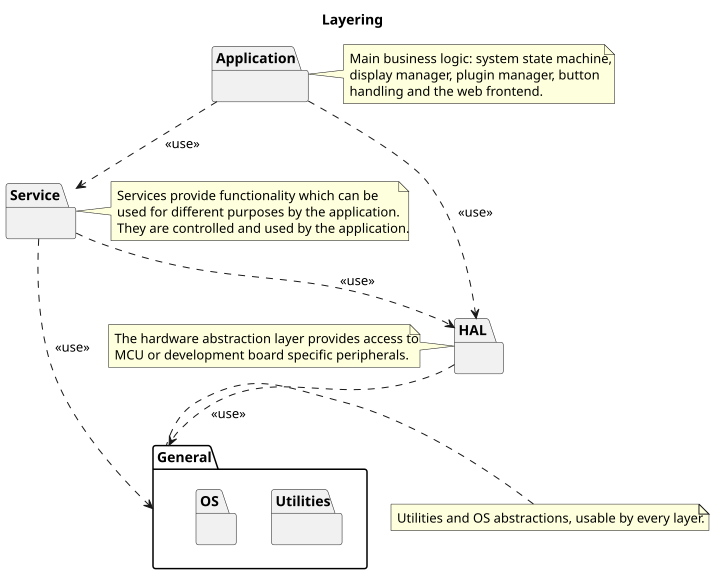

| Layer | Location | Responsibility |
| ----- | -------- | -------------- |
| Application | `src/` | System state machine, display manager, plugin manager, button handling, web frontend |
| Service | `lib/*Service/`, `lib/BaseGfx`, `lib/YAGfx`, `lib/YAWidgets`, `lib/Views`, `lib/FadeEffects`, `lib/Fonts` | Reusable functionality, controlled by the application |
| HAL | `lib/Hal*/`, `src/Hal/` | MCU and board specific peripherals |
| General | `lib/Utilities`, `lib/Os`, `lib/Common`, `lib/Logging` | Utilities and OS abstractions, usable by every layer |

### Application Layer

The application layer owns the system lifecycle. `main` starts the state machine, which drives the system through its states and calls `Services::processAll()` while running.

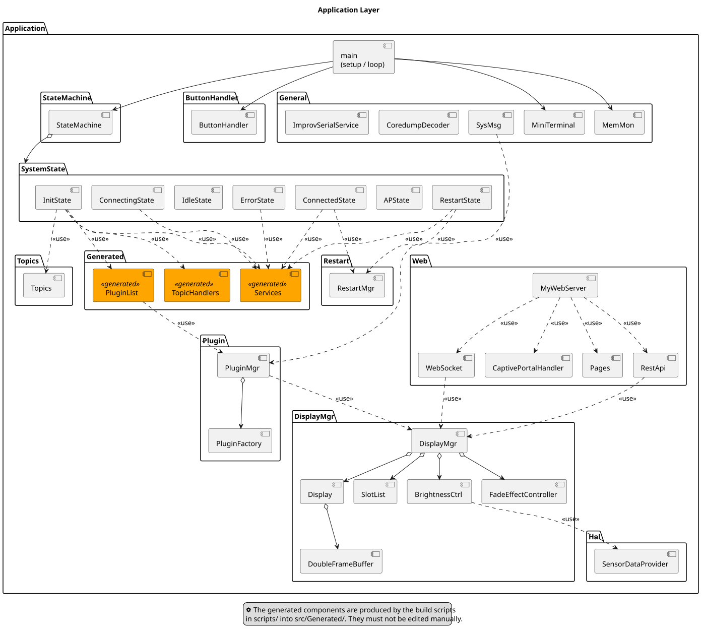

The three components in the `Generated` package are produced by the build scripts in `scripts/` into `src/Generated/`. They must not be edited manually.

### Service Layer

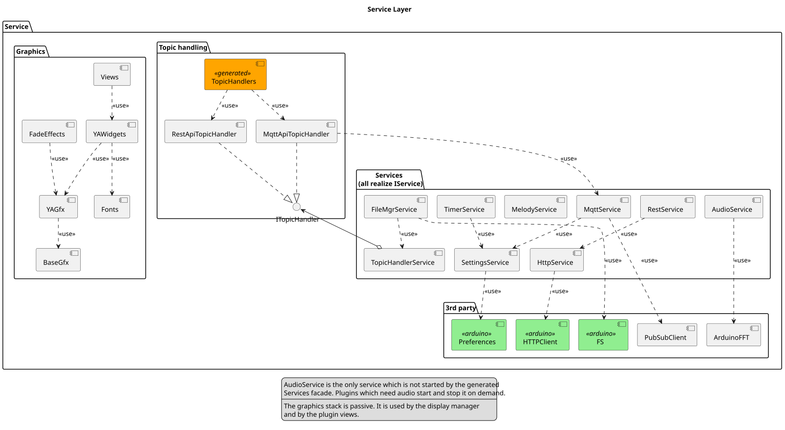

### Hardware Abstraction Layer

The board owns the common ESP32 drivers and exactly one display driver, which is selected at build time by the board environment in [platformio.ini](../../platformio.ini) and [config/display.ini](../../config/display.ini).

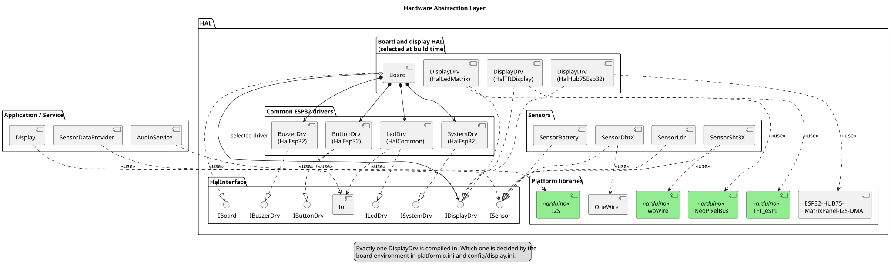

## Services

### Service Interface And Facade

Every service realizes `IService` and is a singleton. The generated `Services` facade is the single place which knows the service list and the start/stop order.

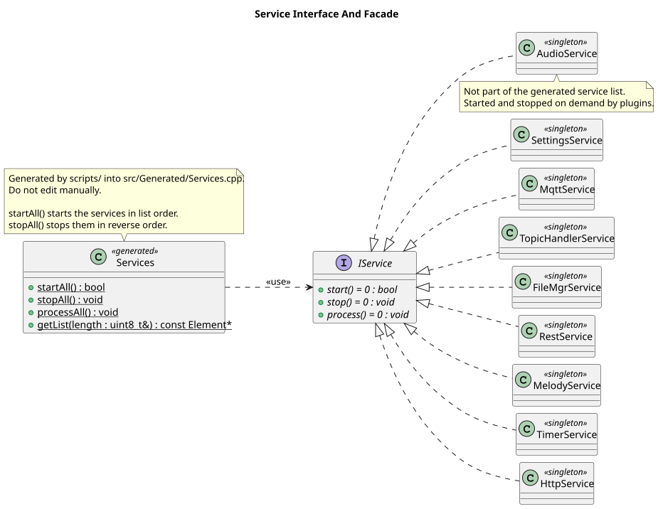

### Service Lifecycle

`Services::startAll()` starts the services in list order. If one of them fails, the already started services are stopped again, so a partially started system is never left running. `Services::stopAll()` stops them in **reverse** order.

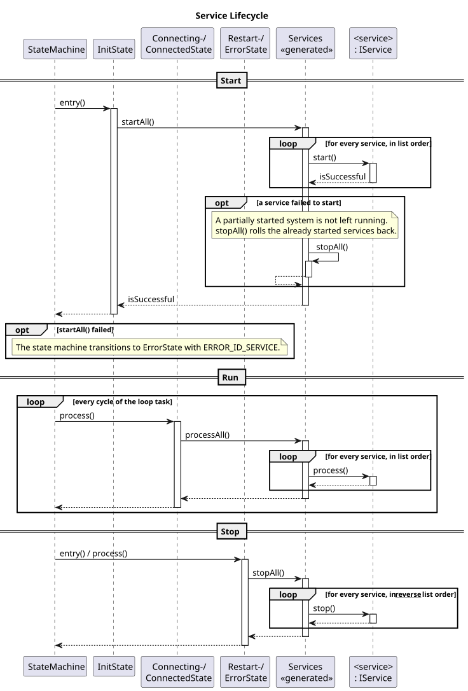

The lifecycle is driven by the system state machine:

| Call | Driven by |
| ---- | --------- |
| `Services::startAll()` | `InitState::entry()`; on failure the state machine goes to `ErrorState` with `ERROR_ID_SERVICE` |
| `Services::processAll()` | `InitState::process()`, `ConnectingState::process()`, `ConnectedState::process()` |
| `Services::stopAll()` | `ErrorState::entry()`, `RestartState::process()` |

### Service Catalogue

The start order below is the order in the generated service list.

| # | Service | Purpose | Settings topic | Configuration file |
| - | ------- | ------- | -------------- | ------------------ |
| 1 | `SettingsService` | Persistent settings in the NVS, via `Preferences` | - | - |
| 2 | `MqttService` | MQTT broker connectivity, publish and subscribe | `mqttService/mqtt` | `/configuration/mqttService.json` |
| 3 | `TopicHandlerService` | Integration hub between the topic APIs and the feature modules | - | - |
| 4 | `FileMgrService` | Access to files in the filesystem | - | - |
| 5 | `RestService` | Outgoing REST requests for plugins, one at a time | - | - |
| 6 | `MelodyService` | Plays a single RTTTL melody on the buzzer | - | - |
| 7 | `TimerService` | Scheduled display control, up to 8 timers, evaluated every 100 ms | `timerService/timer` | `/configuration/timerService.json` |
| 8 | `HttpService` | Outgoing HTTP and HTTPS requests, executed in a worker task | - | - |
| - | `AudioService` | Audio capture, spectrum analyzer and tone detection | - | - |

`AudioService` realizes `IService` as well, but it is **not** part of the generated service list. The plugins which need audio start and stop it on demand.

### Topic Handling

Both REST and MQTT route through `TopicHandlerService` using one unified topic model. A feature module (a plugin or a service) registers its topics once; the registered topic handlers expose them over their respective transport.

| Element | Form |
| ------- | ---- |
| Entity id of a plugin | `display/plugin/<PLUGIN-ALIAS>` |
| REST URL | `<BASE-URI>/[<ENTITY-ID>/]<TOPIC>` |
| MQTT, readable | `<DEVICE-ID>/[<ENTITY-ID>/]<TOPIC>/state` |
| MQTT, writeable | `<DEVICE-ID>/[<ENTITY-ID>/]<TOPIC>/set` |

Every plugin always has a unique alias. The alias is the only plugin address used in a topic path.

A readable topic is published initially after registration, after connection establishment, and on change. `TopicHandlerService` polls the feature modules for changes every 500 ms.

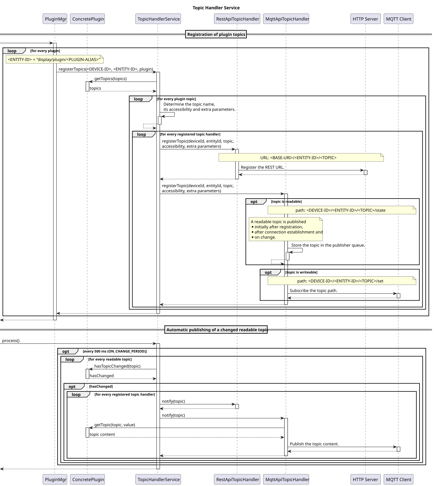

## Plugin Concept

A plugin is a self-contained display unit. It is created by a factory, installed into a display slot, scheduled by the display manager and exposed over the topic APIs.

### Static View

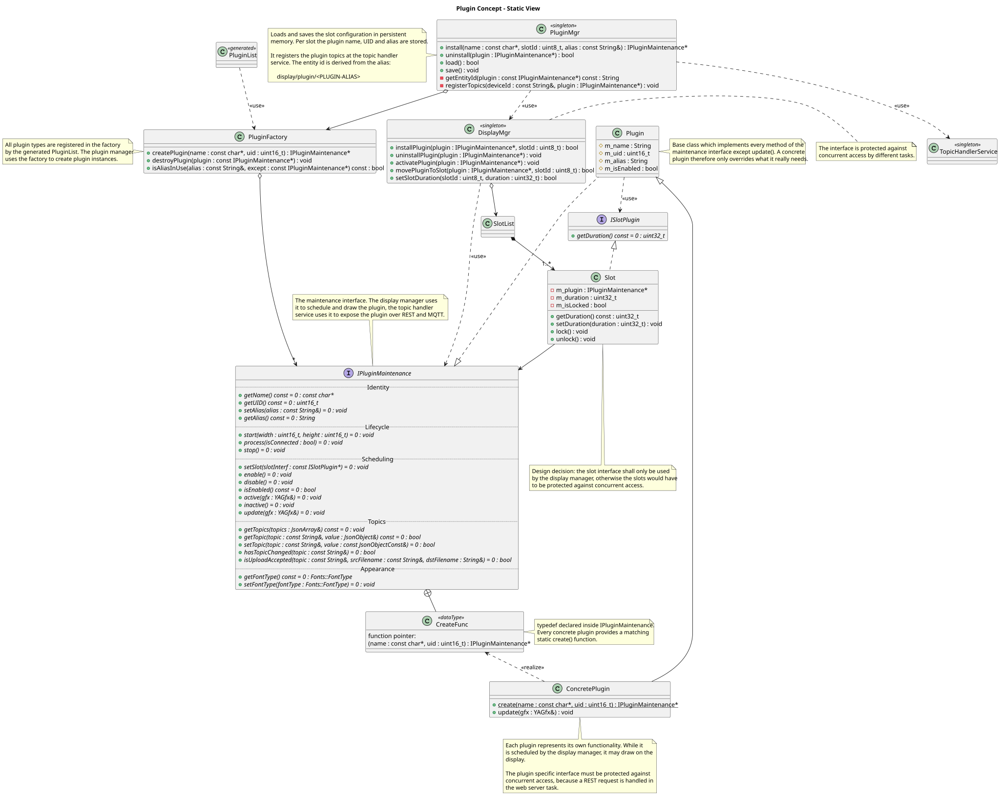

`Plugin` implements every method of `IPluginMaintenance` except `update()`, so a concrete plugin only overrides what it really needs. The plugin specific interface must be protected against concurrent access, because a REST request is handled in the web server task while the plugin is processed in the `processTask`.

### Install And Uninstall

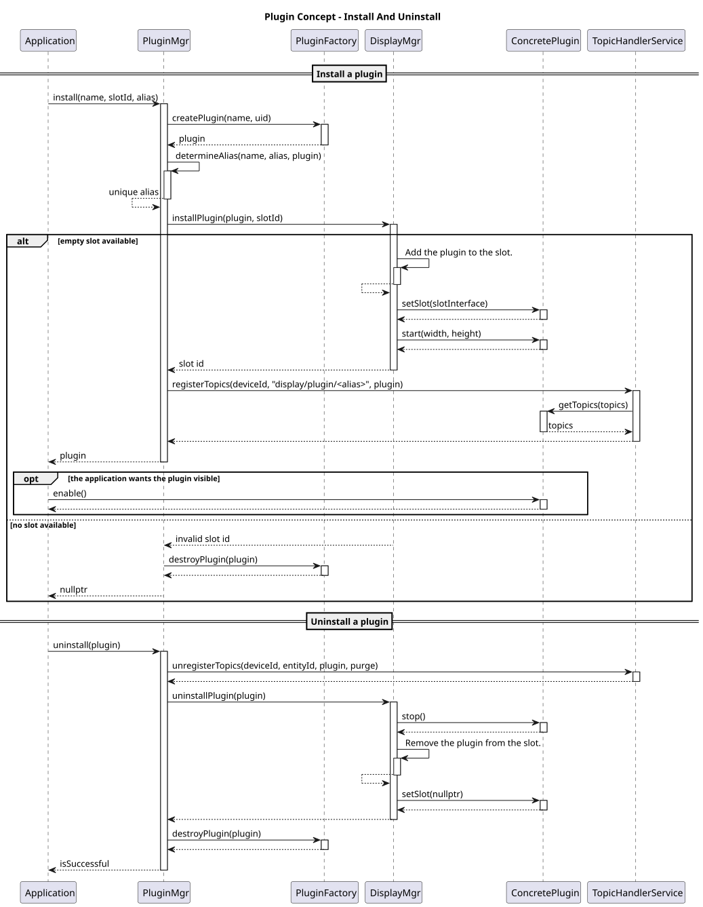

### Configuration Handling

A plugin configuration lives in `/configuration/<PLUGIN-UID>.json`. It is read on `start()` and removed on `stop()`, so unused configurations do not waste flash space.

A write via the topic APIs never touches the flash directly. The topic handler only updates the in-memory configuration and marks it as changed; the plugin writes it during its own processing. This keeps the slow flash access out of the web server task.

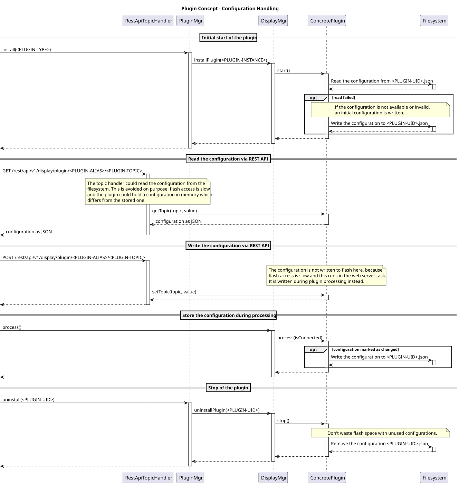

### Slot Scheduling

The display manager cycles through the slots. Each slot holds at most one plugin and has a configurable duration. A duration of 0 ms disables the timer, so the slot stays active until another condition appears.

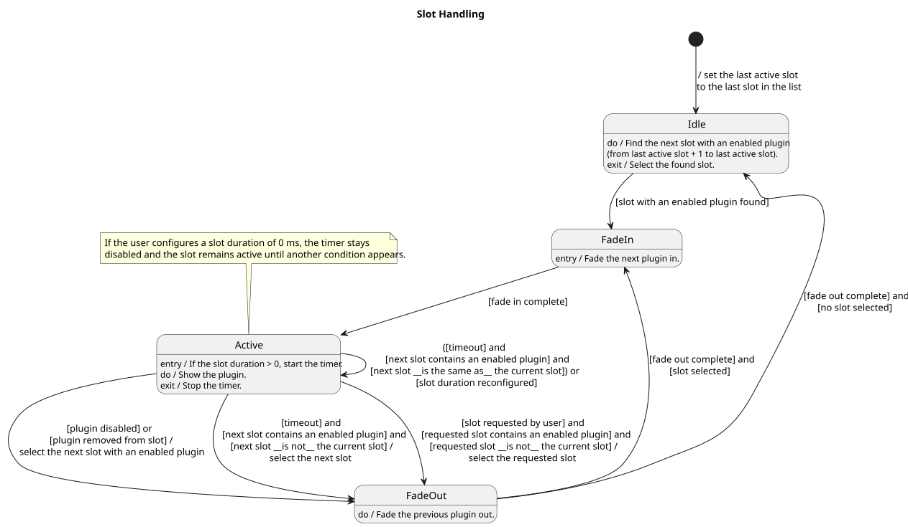

## Runtime Behaviour

### System Startup

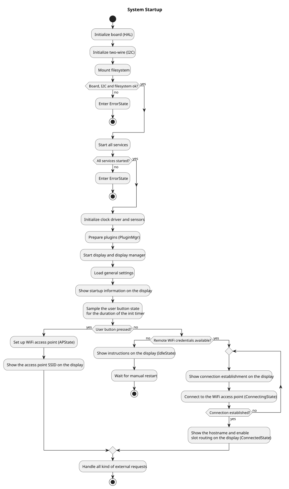

### System States

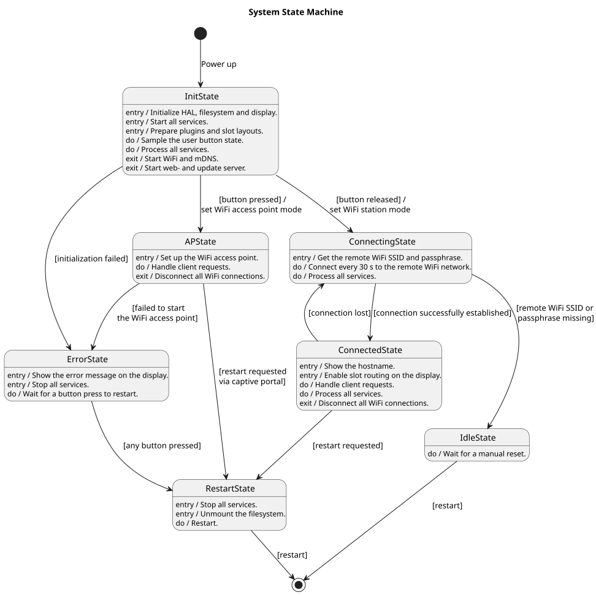

## Component Details

The component level design is documented in [DETAILS.md](DETAILS.md): hardware abstraction layer internals, graphics and widgets, button debouncing, audio service and spectrum analyzer, REST service, MQTT service, timer service, and the topic model reference.

## Diagram Sources

The diagrams are PlantUML. The sources are in [uml/](uml/), the rendered SVGs in [svg/](svg/).

Render them with:

```cmd
plantuml2svg.bat
```

The script downloads `plantuml.jar` on first use and converts every file in `uml/` into `svg/`. The output file name is taken from the name behind `@startuml`, therefore **the diagram name must always match its file name**, otherwise the links in this document break.

## Issues, Ideas And Bugs

If you have ideas or found a bug, create an [issue](https://github.com/BlueAndi/Pixelix/issues). If you want to fix it yourself, clone the repository and open a pull request.

## License

The whole source code is published under the [MIT license](http://choosealicense.com/licenses/mit/).
Consider the different licenses of the used third party libraries too!

## Contribution

Unless you explicitly state otherwise, any contribution intentionally submitted for inclusion in the work by you, shall be licensed as above, without any
additional terms or conditions.
